# 图形学渲染管线 —— 深度学习笔记（游戏客户端秋招向）

> 配套电子书：[`Graphics_Pipeline.html`](Graphics_Pipeline.html)（单文件离线，含 26 张原理图、22 张实测渲染图、3 个交互实验）/ [`Graphics_Pipeline.pdf`](Graphics_Pipeline.pdf)（107 页）
> 配套实测程序：[`demos/soft_raster.cpp`](demos/soft_raster.cpp)（约 1000 行 C++ 软件光栅化器，13 组实验）→ 输出 [`demos/run_output.txt`](demos/run_output.txt) + `demos/out/png/*.png`
> 本笔记是电子书的**精华版**：每章保留结论、公式、实测数字和面试要点；推导细节、插图与交互实验请看电子书。

## 提问记录

| 时间 | 原始提问 | 回答对应章节 |
|---|---|---|
| 2026-10-09 15:44 | 我现在正在准备秋招面试，岗位背景是游戏客户端……为我深度解析**图形学渲染管线**，输出一份质量极高的电子学习书，并有实际的案例配合佐证讲解，同时注意深度；预留一些问题，后续会模拟面试官依次提问图形学问题，也需要详细回答、查漏补缺，并生成额外的 md 文档 | 全文（第 0～13 章）；预留题单见 [§13](#13-预留问题模拟面试题单)；后续问答将落盘到 `Interview_QA/QNN_<主题>/` |

---

## 0. 30 秒面试版答案

> **"请介绍一下渲染管线。"**
>
> 渲染管线分三大段：**应用阶段**在 CPU 上做剔除、排序、合批并提交 Draw Call；**几何阶段**由顶点着色器把顶点从局部空间经 MVP 变换到**裁剪空间**，硬件再做**齐次空间裁剪 → 透视除法 → 视口变换 → 背面剔除**；**光栅化与像素阶段**把三角形离散成片元（定点亚像素 + Top-Left 规则）、做**透视校正插值**，经过 **Early-Z** 后运行像素着色器（纹理采样、光照），最后在输出合并阶段做**模板/深度测试与混合**，写入帧缓冲。可编程的是 VS 和 PS（以及可选的 HS/DS/GS、Mesh Shader），其余是可配置的固定功能。

**2 分钟版要额外打出的 5 个"深度信号"**（每条都有实测佐证）：

1. **w 的意义**：投影矩阵把"距离"放进 w；裁剪必须在除以 w 之前做（E2：相机背后顶点 w=-1，朴素除法把它翻到屏幕上方）。
2. **光栅化是精确的**：8 位亚像素定点 + Top-Left 规则，共享边不漏不重（E4：2131 个边上像素零误差）。
3. **透视校正**：1/w 在屏幕空间线性，属性插值 a/w 和 1/w 再相除（E5：不校正 uv 平均误差 17.4 个纹理重复）。
4. **Early-Z 与绘制顺序**：不透明从前往后，PS 次数 = 可见像素数（E7：599 万 → 22 万次，3764ms → 191ms）。
5. **移动端 TBR**：深度、混合、MSAA 都在片上完成，带宽是第一约束（E12：IMR 流量是 TBR 的 28～134 倍）。

### 管线全景（逐站）

```
CPU 应用阶段 ──Draw Call──▶ 输入装配(IA) ─▶ 顶点着色器(VS) ─▶ [曲面细分 HS/TS/DS] ─▶ [几何着色器 GS]
   剔除/排序/合批                 读VB/IB        局部→裁剪空间       （可选）                （可选，慢）
                                                         │
                       ┌─────────────────────────────────┘
                       ▼
 图元装配 ─▶ 齐次空间裁剪 ─▶ 透视除法(÷w) ─▶ 视口变换 ─▶ 背面剔除 ─▶ 三角形设置/光栅化 ─▶ 属性插值
                 (近平面为主,         NDC              屏幕坐标     有符号面积     边函数/Top-Left      重心坐标
                  x/y 靠保护带)                                                                    透视校正
                                                                                                    │
            帧缓冲 ◀─ 混合 ◀─ 深度/模板测试(Late) ◀─ 像素着色器(PS) ◀─ Early-Z / Hi-Z ◀──────────────┘
                     Blend    Stencil/Depth              纹理/光照/discard     （条件满足才生效）
```

| 类型 | 阶段 | 能控制什么 |
|---|---|---|
| 可编程 | VS、HS/DS/GS、PS、CS、Task/Mesh Shader | 任意代码 |
| 固定功能·可配置 | IA、裁剪、÷w、视口、剔除、光栅化、深度/模板、混合 | 只能设状态（剔除模式、深度函数、混合因子、MSAA…） |

贯穿全书的 3 个"副作用"：**走样**（离散采样）、**精度**（浮点/定点有限位）、**浪费**（Overdraw、Quad、带宽）。

---

## 1. 一帧画面是怎么来的（CPU / GPU 分工）

- CPU 决定**画什么**（游戏线程逻辑 → 渲染线程剔除/排序/录命令 → 驱动提交），GPU 决定**每个像素长什么样**；两者通过**命令缓冲异步**协作，CPU 通常领先 1～2 帧（Frames in Flight）。
- **帧率由最慢的泳道决定**；CPU 同步读 GPU 结果（ReadPixels、立即取遮挡查询）会让流水线排空。
- **Draw Call 贵在 CPU 端**：状态切换（换 Shader/PSO）、资源绑定、常量上传、驱动校验、提交。

| 手段 | 省什么 | 代价 |
|---|---|---|
| 静态合批 | Draw Call | 顶点数据复制 → 内存变大；无法单独剔除 |
| 动态合批 | Draw Call | CPU 每帧变换顶点，只适合小网格 |
| GPU Instancing | Draw Call（同网格大量重复） | 实例数据缓冲；适合草、树、小兵 |
| SRP Batcher | **每次 Draw 的准备开销**（不减 DC 数量） | 需要 Shader 兼容（常量放 CBUFFER） |

- **GPU 的 SIMT 模型**：一个 Warp（NV 32 / AMD 32 或 64 线程）共享指令流；靠"驻留大量 Warp、轮流上场"掩盖访存延迟。
  - **分支发散**：同 Warp 走不同分支 → 两边都执行。uniform 分支（由材质参数决定）几乎免费。
  - **寄存器压力**：寄存器用得多 → 驻留 Warp 少（Occupancy 低）→ 掩盖延迟能力下降。
  - **PS 按 2×2 Quad 打包**：导数的来源，也是小三角形浪费的根源（§6）。
- **统一着色器架构**：VS/PS 是逻辑阶段，物理上跑在同一批 SM/CU 上。
- 光栅化（以物体为序、访存规则）vs 光线追踪（以像素为序、访存随机）；今天主流是"光栅化为主 + 局部光追"。

> ⚠️ **易错**："合批就是为了减少 Draw Call" → 更准确：减少 CPU 端每次绘制的准备开销（主要是 SetPass 和常量上传）。

---

## 2. 坐标空间与变换

```
局部(Object) ─M─▶ 世界(World) ─V─▶ 观察(View, 相机在原点看 -Z) ─P─▶ 裁剪(Clip, 4D) ─÷w─▶ NDC ─视口─▶ 屏幕
└──────────────── 顶点着色器负责：clip = P·V·M·p ────────────────┘   └──── 固定功能硬件 ────┘
```

- **齐次坐标**：让平移、透视都能用矩阵表达。点 `(x,y,z,1)`，方向 `(x,y,z,0)`（平移项被 w=0 消掉）。
- **TRS**：列向量约定 `M = T·R·S`，先缩放→再旋转→后平移。
- **LookAt**：观察矩阵 = 相机世界矩阵的逆；旋转部分正交，逆=转置，直接把 s/u/−f 写成行，平移 = −(基·eye)。up 与视线平行时叉积为 0 → NaN（俯视角相机要处理）。
- **法线用 (M⁻¹)ᵀ**：要保持 nᵀt=0，t'=Mt，n'=Gn ⇒ GᵀM=I ⇒ **G=(M⁻¹)ᵀ**。只有旋转+均匀缩放时可直接用 M。

| 三对约定 | 说明 |
|---|---|
| 行向量 / 列向量 | **数学约定**：列向量 `P·V·M·p`，行向量 `p·M·V·P`，矩阵互为转置 |
| 行主序 / 列主序 | **存储约定**：只影响内存布局；GLSL 和 HLSL cbuffer 默认列主序打包 |
| 左手 / 右手 | 影响叉积方向、正面绕序、投影 z 项符号；Unity/UE 左手，GL/本书右手 |

**🔬 E1 实测：一个顶点的旅程**（立方体角 (0.5,0.5,0.5)，平移(0,0,-5)·绕Y转30°，相机(0,1,3)看向(0,0,-5)）

```
世界 (0.683, 0.500, -4.817) → 观察 (0.683, 0.473, -7.819)
[D3D [0,1]   ] 裁剪 (0.665, 0.820, 7.7264, w=7.819) → NDC (0.0851, 0.1049, 0.988198) → 屏幕 (347.24, 161.12) 深度 0.988198
[OpenGL[-1,1]] 裁剪 (0.665, 0.820, 7.6341, w=7.819) → NDC z=0.976397 → 映射后深度 0.988198
[Reversed-Z  ] 裁剪 (0.665, 0.820, 0.0923, w=7.819) → NDC z=0.011802
```
- **w = −z_view = 7.819**：透视除法就是"除以距离"。
- 三种深度约定 x/y/屏幕坐标完全相同，只有存进深度缓冲的值不同。
- 离相机 7.8m 的点在 near=0.1/far=100 下深度已经是 0.988 —— 深度精度问题的伏笔。

> 🎮 **大世界精度**：float 在 10km 处间隔约 1mm。用 **Camera-Relative Rendering**（CPU 用 double 算"物体−相机"，GPU 只处理小数值），UE5 LWC / HDRP 都这么做。

---

## 3. 投影与裁剪

### 3.1 透视投影矩阵推导（右手系，D3D 深度 [0,1]）

1. 相似三角形：`x' = n·x/(−z)` —— 除法矩阵做不了 → **第 4 行 (0,0,−1,0) 让 w=−z**，除法交给硬件。
2. x/y 缩放：`t = 1/tan(fovy/2)`，第 1、2 行 `(t/aspect,0,0,0)`、`(0,t,0,0)`。
3. z：第 3 行 `(0,0,A,B)`，`z_ndc = −A − B/z`，令 −n→0、−f→1 ⇒ **A = f/(n−f)，B = nf/(n−f)**。

```
P = ⎡ t/aspect  0      0          0      ⎤
    ⎢ 0         t      0          0      ⎥
    ⎢ 0         0   f/(n−f)    nf/(n−f)  ⎥     Reversed-Z：A = n/(f−n)，B = nf/(f−n)
    ⎣ 0         0     −1          0      ⎦     无限远 Reversed：A = 0，B = n（z_ndc = n/d）
```

**关键事实：`z_ndc = a + b·(1/d)`，深度与距离的倒数线性相关。** 它导致：
① 深度可以在屏幕空间直接线性插值；② 属性插值必须透视校正；③ 深度精度极不均匀（near=0.1 时一半深度值用于前 0.2m）。

### 3.2 为什么必须在 ÷w 之前裁剪

- 相机背后的点 **w<0**，除法让 x/y 变号 → 被翻到屏幕另一侧；w=0 → 除零。
- 裁剪空间与观察空间是线性关系，在 4D 里线性插值出的新顶点是正确的。
- 视锥 = 6 个不需要除法的不等式：`−w≤x≤w，−w≤y≤w，0≤z≤w`（GL：`−w≤z≤w`）；Sutherland–Hodgman 逐平面切。

**🔬 E2 实测**：A、B 在相机前 2m，C 在相机后 1m（w=−1）
```
顶点C  clip=(0.487,-0.866,-1.101, w=-1.000)  朴素除法->屏幕(164.1, 24.1)  <-- w<0：被翻到屏幕另一侧！
近平面裁剪后得到 4 个顶点（三角形→四边形→扇形 2 个三角形）；P2 屏幕坐标 (2450.4, 1738.8) 远在屏幕外
实际光栅化：输入 1 个三角形，被裁剪 1 个，送入光栅化 2 个，覆盖 38760 个像素
```
- **保护带（Guard Band）**：GPU 定点坐标范围远大于屏幕，x/y 基本不真正裁剪，靠包围盒/Scissor 丢弃；**必须裁的只有近平面**（及超出保护带的情况）。远平面可用"深度钳制"关闭裁剪（阴影常用）。

| API | NDC 深度 | NDC y | 屏幕原点 |
|---|---|---|---|
| D3D11/12 | [0,1] | 上 | 左上 |
| OpenGL | [−1,1]（可 glClipControl） | 上 | 左下 |
| Vulkan | [0,1] | **下** | 左上 |
| Metal | [0,1] | 上 | 左上 |

> 🎮 near 不能太小（精度，E6：near 0.1→1.0，1000m 处 Z-Fighting 30.5%→0%）也不能太大（穿模）。正交投影 w≡1，深度线性、精度均匀，不需要透视校正。

---

## 4. 顶点处理与图元装配

- **VB + IB + Post-Transform 顶点缓存**：共享顶点只着色一次。UV 球 64×32：2145 顶点 / 3968 三角形 / 11904 索引 → 理想缓存下 VS 次数省 82%。衡量指标 **ACMR**（规则网格 ≈0.5，乱序 ≈3），用 meshoptimizer/Forsyth 重排。
- **"顶点" = 所有属性的组合**：立方体是 24 个顶点（每角 3 个面法线不同）；硬边、UV 接缝都会复制顶点。
- 可选阶段：曲面细分（产生小三角形，移动端少用）；**几何着色器普遍慢**（输出不定、Metal 不支持）；**Mesh Shader** 以 Meshlet（~64 顶点/126 三角形）为单位生成并剔除，是现代替代方案。
- **背面剔除 = 屏幕空间有符号面积**：`2A = (x1−x0)(y2−y0) − (y1−y0)(x2−x0)`，符号定正反，0 为退化。精确、免费（光栅化本来就要算）。

**🔬 E3 实测：背面剔除率随距离变化**（64×32 球）

| 相机距离 / 半径 | 1.5 | 3 | 10 | 100 |
|---|---|---|---|---|
| 实测剔除率 | **86.9%** | 72.3% | 58.0% | 50.5% |
| 理论 1−(1−r/d)/2 | 83.3% | 66.7% | 55.0% | 50.5% |

- 剔除率**不是固定 50%**，近处更高；背面剔除**不省顶点着色**。
- **剔除漏斗**：CPU 视锥剔除 → 遮挡剔除（PVS/软光栅/Hi-Z 查询）→ GPU 驱动剔除（CS/Mesh Shader）→ 裁剪+背面+零面积 → Hi-Z/Early-Z。越早省得越多、粒度越粗。
- 双面材质（树叶、披风）要 Cull Off 并在 PS 用 `SV_IsFrontFace` 翻法线；负缩放会翻转绕序。

---

## 5. 光栅化：像素归谁

- **覆盖 = 采样点（默认像素中心）落在三角形内**；部分覆盖但没盖住中心不算 → 几何走样。
- **边函数** `E_ab(p) = (b.x−a.x)(p.y−a.y) − (b.y−a.y)(p.x−a.x)`：
  - 三个同号即在内；是线性函数 → 可**增量计算**（右移一像素 `E −= (b.y−a.y)`）、可对整块像素用四角**快速接受/拒绝**；
  - 等于 2 倍有符号面积 → **除以总面积就是重心坐标**。
- **定点亚像素**（D3D11 要求 8 位，1/256 像素）：整数边函数**精确、水密、确定**（确定性是 Z-Prepass + EQUAL 能工作的前提）。PS1 无亚像素精度 → 顶点抖动。
- **Top-Left 规则**：E=0 的样本只在**上边**（水平、其余部分在下方）或**左边**上才算覆盖；实现 = 非上/左边给 E 减 1。

```cpp
auto isTL = [&](int a, int b) { i64 dx = X[b] - X[a], dy = Y[b] - Y[a];
                                 return (dy == 0 && dx > 0) || dy < 0; };   // 屏幕 y 向下、面积已调为正
i64 b0 = (!isTL(1, 2)) ? -1 : 0;  ...  cov = (w0 + b0 >= 0) && (w1 + b1 >= 0) && (w2 + b2 >= 0);
```

**🔬 E4 实测**

| 配置 | 漏画 | 重复画 |
|---|---|---|
| 网格（450 三角形，顶点在像素中心）定点 E≥0 全收 | 0 | **2131** |
| 同上 E>0 全不收 | **2131** | 0 |
| 同上 Top-Left | **0** | **0** |
| 随机亚像素抖动网格 定点 Top-Left（含坐标 +32768） | 0 | 0 |
| 720 条长边扇形 float 边函数，坐标 +3000 | 2 | 1 |
| 同上，坐标 +12000 | 1 | 1 |
| 同上 定点（任意平移） | 0 | 0 |

- 遍历：包围盒（简单、细长三角形浪费）→ 分块 + 层次化（配合 Hi-Z、Quad 打包）。
- 🎮 模型"闪点"多半不是光栅化器的错，而是共享顶点坐标不一致（LOD 接缝、地形块高度、VS 计算顺序不同）；**保守光栅化**用于体素化/光源分块；CPU 软光栅用于遮挡剔除。

---

## 6. 属性插值：重心坐标、透视校正与 2×2 Quad

- 屏幕空间线性插值是错的：三维中等距的点投影后越远越挤。
- **推导结论：1/w 与 a/w 在屏幕空间线性，a 本身不是。**

$$a(p) = \frac{\sum \lambda_i\, a_i / w_i}{\sum \lambda_i / w_i}$$

- **深度不需要校正**：z_ndc = z_clip/w 本身就是"÷w"形式 → 这正是深度缓冲存 z/w 的原因（代价是精度不均）。

**🔬 E5 实测**（地面 0.5～60m，射线求交得 uv 真值）

| 配置 | 平均 uv 误差 | 最大 | 近处(<5m) |
|---|---|---|---|
| 仿射插值，2 个三角形 | **17.44** | 20.20 | 17.04 |
| 仿射插值，细分 512 三角形 | 0.379 | 0.684 | 0.468 |
| 透视校正，2 个三角形 | **0.0001** | 0.0066 | 0.0000 |

> uv 单位 = 纹理重复次数，1 格 = 0.5。细分能缓解（PS1 的做法）但不能消除。

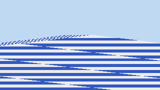 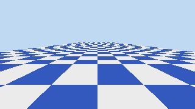 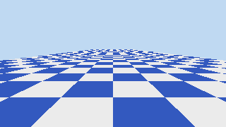

| 修饰符 | 含义 | 用途 |
|---|---|---|
| `linear`（默认） | 透视校正 | uv、法线、世界坐标 |
| `nointerpolation` / `flat` | 取激发顶点的值 | ID、整数、Low-Poly 平直着色 |
| `noperspective` | 屏幕空间线性 | 线框距离、屏幕空间 UV |
| `centroid` | MSAA 下在被覆盖样本重心求值 | 图集边缘串色、uv 越界 |
| `sample` | 每样本求值（变 SSAA） | 边缘高频着色 |

- **2×2 Quad**：PS 永远以 2×2 为单位执行；`ddx = 右邻 − 自己`，`ddy = 下邻 − 自己`；三角形外的像素作为 **Helper Lane** 陪跑。分支里调用 `Sample()` 导数未定义 → 用 `SampleGrad`/`SampleLevel`。

**🔬 E8 实测：Quad 效率 = 覆盖像素 / PS 通道**（每组 3000 个三角形）

| 面积 px² | 0.5 | 1 | 2 | 4 | 8 | 16 | 64 | 256 | 1024 | 4096 | 细长64 | 细长256 |
|---|---|---|---|---|---|---|---|---|---|---|---|---|
| Quad 效率 | **25.0%** | 27.1% | 33.6% | 41.1% | 49.6% | 58.2% | 73.5% | 84.7% | 91.7% | 95.7% | 47.9% | **48.3%** |

- 0.5px 三角形 3000 个里 **1511 个零覆盖**（VS 和三角形设置白做）。细长三角形面积 256 却只有 48%（几乎全是边缘）。
- 🎮 Micro-Triangle 对策：LOD 保证三角形面积；远处不开细分；Nanite 对小三角形改用计算着色器软光栅。

---

## 7. 片元着色与纹理采样

- PS 写法会反作用于固定功能：`discard` → 深度写入推迟（TBDR 的 HSR 也被打断）；写 `SV_Depth` → Early-Z 关闭（可用保守深度挽回）；写 UAV 需 `[earlydepthstencil]`。
- **放大**（texel > 像素）→ 块状 → 双线性插值；**缩小**（像素覆盖多个 texel）→ 采样率低于奈奎斯特 → 摩尔纹/闪烁 → **必须先低通滤波 = Mipmap**。
- Mipmap：内存 +33%；**LOD 公式**：

```
ρ = max( |(∂u/∂x·W, ∂v/∂x·H)|, |(∂u/∂y·W, ∂v/∂y·H)| )      LOD λ = log₂ ρ   （导数来自 2×2 Quad）
```

| 过滤 | 每次读 texel | 问题 |
|---|---|---|
| 点采样 | 1 | 马赛克 / 严重闪烁 |
| 双线性 | 4 | 缩小时仍走样 |
| 三线性 | 8 | 斜视过度模糊（按长边选 LOD） |
| 各向异性 N× | ≤8N | 贵；按短边选 LOD、沿长轴取多样本 |

**🔬 E9 实测**（高 1m 视角、延伸 300m 的棋盘地面；参考 = 64× 超采样）

| 方式 | RMSE 全图 | 近<3m | 中3~12m | 每像素 texel | 缓存命中 | 平均 LOD |
|---|---|---|---|---|---|---|
| 点采样 LOD0 | 0.306 | 0.215 | 0.369 | 1.0 | 80.8% | 0 |
| 双线性 LOD0 | 0.221 | 0.087 | 0.291 | 4.0 | 93.7% | 0 |
| 三线性 Mipmap | 0.087 | 0.055 | 0.127 | 7.6 | **99.3%** | 2.50 |
| 三线性 + 16× 各向异性 | **0.026** | 0.017 | 0.029 | **39.3** | 98.5% | 0.70 |
| 三线性 + LOD Bias −2 | 0.122 | 0.087 | 0.172 | 5.8 | 97.0% | 2.50 |

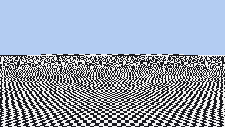 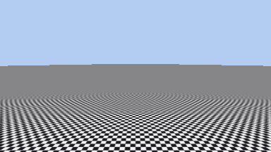 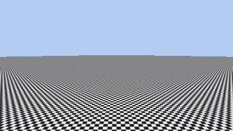

- **Mipmap 同时降误差（−60%）和省带宽（命中率 99.3%）**，"开 Mipmap 更慢"是错误直觉；它让远处**更模糊**而不是更清楚。
- 负 LOD Bias "看着锐"其实重新引入走样（TAA/DLSS 刻意用负 Bias，靠时域累积去走样）。
- 纹理缓存按 Tile/Morton 排布；**块压缩**（BCn/ASTC/ETC2，4×4 块固定码率、硬件解压）带宽降为 1/8～1/9，移动端统一 ASTC；颜色贴图 sRGB、数据贴图线性；依赖纹理读取降低延迟隐藏能力。
- 🎮 Mip Streaming 按屏幕尺寸加载 Mip；图集要留 padding 防低 Mip 渗色；UI 1:1 显示通常不需要 Mip。

---

## 8. 深度与可见性：Z-Buffer、Early-Z、Reversed-Z

- Z-Buffer：不透明物体与绘制顺序无关（引擎可按材质排序）；只记一层 → 处理不了半透明。
- **Early-Z** 失效/受限条件：① PS 写深度（完全失效）② discard/Alpha Test（可早测、不能早写）③ Alpha To Coverage ④ 写 UAV 未声明 earlydepthstencil ⑤ 帧中途改变比较方向（Hi-Z 失效）⑥ 从后往前画（能测但剔不掉）。
- **Hi-Z**：每 Tile 存保守最远深度，整块跳过。

**🔬 E7 实测**（640×360，400 个不透明矩形，平均 Overdraw 26.7，PS 为 48 次循环）

| 画法 | 光栅片元 | PS 执行 | Overdraw | 耗时 ms |
|---|---|---|---|---|
| Late-Z 随机顺序 | 5,992,422 | **5,992,422** | 26.69 | 3763.7 |
| Early-Z 随机顺序 | 5,992,422 | 737,983 | 3.29 | 510.8 |
| Early-Z **从前往后** | 5,992,422 | **224,506** | **1.00** | **190.8** |
| Early-Z 从后往前 | 5,992,422 | 5,992,422 | 26.69 | 3771.3 |
| Z-Prepass + EQUAL | 11,984,844 | 224,506 | 1.00 | 248.2 |

- 随机顺序的期望更新次数 = 调和级数 ≈ ln N + 0.58（所以随机顺序 Early-Z 已经很有效）。
- **Z-Prepass**：不依赖排序，代价是两遍几何；PS 便宜/顶点多的场景、**移动端 TBDR（硬件 HSR）** 上通常亏。

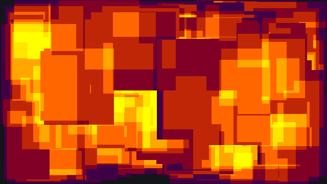

### 深度精度与 Reversed-Z

**🔬 E6 精度表**（near=0.1, far=10000；相邻两个可表示深度值对应的世界距离差）

| 距离 | 标准Z float | 标准Z 24bit | GL float | Reversed float |
|---|---|---|---|---|
| 10m | 5.96e-5 m | 5.96e-5 m | 2.98e-5 m | 9.31e-7 m |
| 100m | 6.0 mm | 6.0 mm | 3.0 mm | 0.012 mm |
| 1000m | **0.596 m** | 0.596 m | 0.298 m | **0.073 mm** |
| 5000m | 14.9 m | 14.9 m | 7.45 m | 0.23 mm |

- 标准 Z：z=0.5 ↔ 0.2m，z=0.99 ↔ 9.99m —— **一半深度值花在前 0.2 米**；误差 ∝ d²/near → **增大 near 收益最大**。
- **Reversed-Z 原理**：投影把远处挤在一起 + 浮点在 0 附近最密 → 反转后远处映射到 0，两种不均匀**互相抵消**，相对精度近似恒定。**前提：D32F**；24 位定点均匀分布，反转无效。

**🔬 E6 渲染实测**（绿墙在红墙后 0.25m 且先画，统计"绿色穿出"比例）

| 配置 | 100m | 300m | 1000m | 3000m | 8000m |
|---|---|---|---|---|---|
| 标准Z float near=0.1 | 0 | 0 | **30.5%** | 44.3% | 50.4% |
| 标准Z 24bit near=0.1 | 0 | 0 | 30.5% | 44.3% | 50.4% |
| 标准Z float near=1.0 | 0 | 0 | **0** | 46.8% | 43.8% |
| OpenGL float near=0.1 | 0 | 0 | 35.1% | 43.0% | 49.1% |
| **Reversed float** | 0 | 0 | 0 | 0 | **0** |

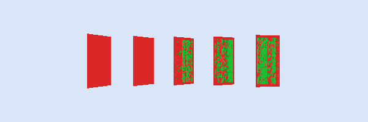 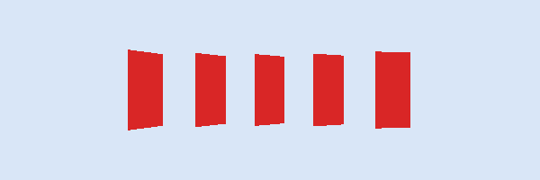

- 标准 Z 下 float 与 24 位结果一样（[0.5,1) 的 float 间隔恰为 2⁻²⁴）；GL 的 [−1,1] 更差。
- Z-Fighting 修复优先级：**增大 near** → Reversed-Z+D32F → 避免共面 → 深度偏移 → 贴花改模板/延迟贴花 → 对数深度/分层相机。
- 后处理要线性深度：标准 `d = n·f/(f − z(f−n))`；Reversed `d = n·f/(z(f−n) + n)`。
- 🎮 绘制顺序：不透明大致前→后且按材质合并 → 天空盒在不透明之后 → Alpha Test 物体在纯不透明之后 → 半透明后→前。E13 主 Pass 先画立方体和球、最后画地面，地面 8215 个片元被 Early-Z 剔除。

---

## 9. 输出合并：模板、混合、抗锯齿

- 顺序：Scissor → (Alpha Test) → **模板** → **深度** → **混合** → 写掩码 → 帧缓冲（MSAA Resolve）。
- **模板（8 位像素标签）**：描边、遮挡剪影（ZTest Greater）、UI 遮罩、传送门/镜子、延迟光源体积、阴影体（Depth-Fail）。引擎要统一分配模板位。
- **混合方程** `C = Csrc·Fsrc ⊕ Cdst·Fdst`：Over（SrcAlpha/OneMinusSrcAlpha，**不可交换**）、预乘（One/OneMinusSrcAlpha）、加法（One/One，可交换）、乘法（DstColor/Zero，可交换）。

**🔬 E11 实测**：白底上叠 3 层 alpha=0.5 的 R/G/B，**6 种顺序得到 6 种颜色**（R→G→B=(0.25,0.375,0.625)，B→G→R=(0.625,0.375,0.25)…）；Additive 6 种顺序全是 (1.3,1.3,1.3)。

- 半透明：**从后往前、开深度测试、关深度写入**；物体级排序在穿插/自身多层时必错 → 先背面后正面两 Pass / 深度预写 / **OIT**（深度剥离、逐像素链表、WBOIT、MLAB）。
- **预乘 Alpha**（E11）：直通 Alpha 过滤后混合 = (0.25, 0.75, 0.25)（黑边），预乘 = (0.5, 1.0, 0.5)（正确）；还能用一个混合状态同时表达 Over 与 Additive。

| AA 方案 | 解决 | 代价 |
|---|---|---|
| SSAA | 几何 + 着色 | PS/带宽/显存 ×N |
| MSAA | 几何边缘 | 存储/带宽 ×N（IMR），PS ≈1×；对着色走样无效；延迟渲染难用 |
| FXAA/SMAA | 几何（部分） | 便宜；糊细节、时间不稳定 |
| TAA | 几何 + 着色 + 部分纹理 | 需运动矢量；拖影/鬼影、偏软 |

**🔬 E10 实测**（与 256 样本参考比较）

| 方式 | RMSE 边缘 | RMSE 内部（高频着色） | PS 执行 | 深度/颜色样本 | 边缘(纯色) |
|---|---|---|---|---|---|
| 无 AA | 0.1835 | 0.1683 | 4705 | 4705 | 0.2569 |
| MSAA 4× | 0.1175 | **0.1683**（无改善） | **4946**（+5%） | 18810 | **0.1063** |
| SSAA 4× | 0.0620 | **0.0067** | 18810（4×） | 18810 | **0.1063** |

- **几何走样上 MSAA 4× ≡ SSAA 4×**，PS 只多 5%；**着色走样 MSAA 无效**；两者存储都是 4 倍。
- 细节：4× 旋转栅格采样点；PS 默认在像素中心求值（可 centroid）；Alpha To Coverage 让 Alpha Test 边缘也能被 MSAA 平滑。
- 🎮 移动端 TBR 上 MSAA 片上 Resolve 几乎免费 → 前向手游首选 MSAA 2×/4× + Memoryless 多采样缓冲；中途读深度/抓屏会破坏这个优势。

---

## 10. GPU 硬件视角：IMR vs TBR/TBDR

| | IMR（NVIDIA/AMD 桌面） | TBR/TBDR（Mali/Adreno/PowerVR/Apple） |
|---|---|---|
| 流程 | 三角形按提交顺序流过管线 | ① Binning：整帧顶点处理、三角形分到 Tile、图元列表写 DRAM ② 逐 Tile 在片上光栅化/深度/混合/MSAA |
| 帧缓冲 | 每次深度读写、颜色写都到 DRAM（靠 L2 + 压缩缓解） | 片上 Tile 内存，Tile 结束只写回一次颜色 |
| 隐藏面 | Early-Z / Hi-Z | TBDR 着色前 HSR（PowerVR HSR / Mali FPK / Adreno LRZ 等） |
| 怕什么 | 带宽、Overdraw | 顶点过多（Binning）、中途读回帧缓冲（Flush）、Alpha Test（打断 HSR）、RT 频繁切换 |

**🔬 E12 实测（简化模型，用 E7 统计）**

| 画法 | IMR KB | TBR KB | IMR/TBR |
|---|---|---|---|
| Early-Z 随机 | 29173 | 900 | 32.4× |
| Early-Z 前→后 | 25162 | 900 | 28.0× |
| Early-Z 后→前 | 70224 | 900 | **78.0×** |
| Z-Prepass | 50576 | 900 | 56.2× |
| MSAA4× + Resolve | 121194 | 900 | **134.7×** |

- TBR 的 DRAM 流量与 Overdraw、绘制顺序、MSAA 无关（但 Overdraw 仍耗片上 ALU 和纹理带宽）。真实 IMR 有缓存/压缩，这是量级上限。
- **Load/Store Action**：Load = Clear/DontCare（0 带宽）/Load（读整屏）；Store = Store/DontCare(Memoryless)。**TBR 上 Clear 最便宜**，"不清除"才要读 DRAM。
- Vulkan Subpass / Metal Tile Shader / Framebuffer Fetch：G-Buffer 可以完全不写回（Memoryless 延迟渲染）。
- **移动端清单**：Clear/DontCare + 深度 Memoryless；减少 RT 切换、合并后处理为 Uber Pass；MSAA 片上 Resolve；少 Alpha Test；控制半透明面积；ASTC+Mip；half 精度（FP16 吞吐 2×、寄存器减半）；控制顶点数。

> ⚠️ 屏幕扭曲（抓屏）在 PC 流畅、在手机掉帧：TBR 上强制结束 RenderPass、整屏写回再读回，并打断 HSR/MSAA 片上优势。

---

## 11. 综合案例：Shadow Map 两遍渲染 + 渲染路径

**E13 场景**：12×12m 地面（三线性纹理）+ 旋转立方体 + 球 + 平行光。

| Pass | 相机 | 目标 | 管线阶段 |
|---|---|---|---|
| 1 Shadow | 光源方向正交投影（14m×14m，深度 30m） | 1024² 深度，无颜色、无 PS | VS → 裁剪 → 光栅化 → 深度写 |
| 2 Main | 主相机透视 | 480×270 颜色+深度 | VS → 裁剪 → 背面剔除 → 光栅化 → 透视校正 → Early-Z → PS（三线性 + Blinn-Phong + 阴影查询 + 3×3 PCF） |

- 查询：`lit = (z_light − bias ≤ ShadowMap[sx,sy])`。
- **痤疮**：一个阴影 texel 覆盖一段表面却只存一个深度 → bias 太小时一半表面判为自阴影；**彼得潘**：bias 太大 → 接触处漏光、阴影与物体脱开；光线越斜需要越大 bias → **斜率缩放偏移**。

**🔬 E13 实测**（与逐像素射线求交真值比较）

| 深度偏移 | 误判为阴影 | 漏光 |
|---|---|---|
| bias = 0 | **46.65%** | 0.02% |
| 常量 0.0005（≈1.5cm） | 0.28% | 0.03% |
| 常量 0.003（≈9cm） | 0.02% | 0.03% |
| 斜率缩放 0.0002+0.0006·tanθ | **0.02%** | 0.03% |
| 常量 0.02（≈60cm） | 0.02% | **0.08%**（2.7×） |

主 Pass：输入 2348 三角形，背面剔除 1246（53%），片元 84016，PS 75801，**Early-Z 剔除 8215**（先画物体后画地面）。Shadow Pass 8.8ms / Main 9.4ms（单线程 CPU 软光栅）。

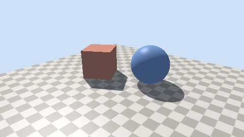 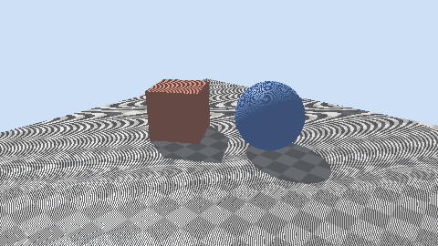 

- 真实引擎：硬件 `DepthBias/SlopeScaledDepthBias`、Normal Offset、Shadow Pass 剔除正面、比较采样器（`SampleCmp`）做硬件 PCF、CSM（MOBA 一两级即可）；手游常见"英雄实时阴影 + 场景烘焙 + 低端机圆形假阴影"。

| 渲染路径 | 优点 | 缺点 | 适用 |
|---|---|---|---|
| 前向 Forward | 简单、MSAA、半透明、材质自由、带宽低 | 物体×光源组合爆炸、Overdraw 浪费光照 | 手游主流 |
| 延迟 Deferred | 光照与几何解耦，复用 G-Buffer | G-Buffer 带宽大、不支持半透明与 MSAA、材质受布局限制 | PC/主机；移动端需 Memoryless |
| Forward+ / Clustered | 大量光源 + 保留前向优点 | 需要计算着色器与光源列表；Tile 内光源不均有发散 | 新项目常用 |

> ⚠️ "延迟渲染光源再多也不影响性能"是错的：每盏光仍要读覆盖区域的 G-Buffer → Tiled/Clustered Deferred。

---

## 12. 性能分析：沿着管线找瓶颈

1. **CPU 还是 GPU**：哪条线程耗时 ≈ 帧时间。手机还要看**长时间稳定帧率与功耗**（发热降频）。
2. **GPU 内部改一个变量**：降分辨率有效 → 像素相关；换 1×1 纹理有效 → 纹理带宽；PS 输出常量有效 → ALU；关混合/MSAA 有效 → ROP/帧缓冲带宽；换低 LOD 有效 → 顶点；关阴影有效 → 阴影几何。
3. **截帧定位**：RenderDoc / Xcode GPU Capture / Snapdragon Profiler / Arm Mobile Studio / Unity Frame Debugger / UE `stat gpu`、`ProfileGPU`。

| 阶段 | 症状 | 手段 |
|---|---|---|
| CPU 应用 | DC/SetPass 多 | 剔除、合批、Instancing、SRP Batcher、减变体、多线程录制 |
| 顶点 | 减面有效 | LOD、压缩顶点属性、索引重排、阴影用低模 |
| 光栅化 | 微小/细长三角形 | LOD、远处不细分、软光栅 |
| 像素 | 降分辨率有效 | 降 Overdraw、half、挪到 VS/预计算、减分支发散、动态分辨率 |
| 纹理 | 换小纹理有效 | Mip、ASTC、减采样、通道打包、各向异性只给地面 |
| 深度 | Early-Z 失效 | 避免 discard/写深度、Alpha Test 后画、Reversed-Z |
| 混合 | 特效/UI Overdraw | 控制面积与层数、特效低分辨率 RT、UI 裁透明区 |
| 帧缓冲带宽 | 发热 | Clear/DontCare、Memoryless、少切 RT、合并后处理 |

**团战掉帧排查流程（面试答法）**：复现 → CPU/GPU 归因 → GPU 内部改变量（降分辨率 70% 帧率回升 → 像素瓶颈，Overdraw 视图 15～20 层）→ 截帧按耗时排序（大招全屏半透明面片 + Additive + Grab Pass 扭曲）→ 对症（面片裁形状、同屏特效上限与降级、低端机关扭曲、ASTC+Mip+通道打包、特效半分辨率 RT）→ 回放录像验证平均帧/1% Low/功耗 → 资源规范化防回退。

其他：Shader 变体爆炸（shader_feature、剥离、预热/PSO 缓存）；half 精度别用于世界坐标/大 UV/时间累加；动态分辨率兜底；帧率稳定比峰值重要。

---

## 13. 预留问题：模拟面试题单

> 后续模拟面试按此题单逐题深挖；每题回答后单独落盘到 `Interview_QA/QNN_<主题>/`（格式：原文保留"我的回答" → 评分 + 问题表 → 满分口述版 → 深度讲解 + 实测 → 追问 → 速记卡），并回填本表"落盘文档"列。

| # | 题目 | 考察点 | 落盘文档 |
|---|---|---|---|
| G01 | 从调用 DrawIndexed 到像素出现在屏幕上，完整讲一遍（含驱动和交换链） | 全局串联、CPU/GPU 同步 | — |
| G02 | 手推透视投影矩阵，并说明为什么 z 不能直接用 −z_view | 投影、深度插值 | — |
| G03 | 为什么 1/w 在屏幕空间是线性的？给出证明 | 透视校正数学 | — |
| G04 | Hi-Z 和 Early-Z 的区别？GPU 驱动的 Hi-Z 遮挡剔除怎么做？ | 可见性层次 | — |
| G05 | Alpha Test 和 Alpha Blend 各自的问题？草地/树叶怎么渲染最好？ | Early-Z、HSR、A2C、排序 | — |
| G06 | MSAA 的 Resolve 发生在哪？延迟渲染下怎么做抗锯齿？ | AA 与渲染路径 | — |
| G07 | TAA 的实现细节：抖动序列、运动矢量、历史裁剪、鬼影处理 | 时域方法 | — |
| G08 | 级联阴影（CSM）的划分策略与抖动（Shimmering）问题 | 阴影工程 | — |
| G09 | PCF、PCSS、VSM、ESM 的区别 | 软阴影 | — |
| G10 | Forward+ / Clustered Shading 的光源分配怎么做？ | 计算着色器、光源剔除 | — |
| G11 | G-Buffer 怎么设计？法线如何压缩？移动端怎么做延迟渲染？ | 延迟渲染、带宽 | — |
| G12 | OIT 有哪些方案，各自优缺点？ | 半透明 | — |
| G13 | Shader 变体是什么？变体爆炸怎么处理？ | 工程化 | — |
| G14 | GPU Instancing 的原理？和 SRP Batcher 能同时用吗？ | CPU 优化 | — |
| G15 | Mesh Shader / Nanite 的思路？为什么能处理海量三角形？ | 现代几何管线 | — |
| G16 | Occupancy 是什么？寄存器数怎么影响性能？ | GPU 执行模型 | — |
| G17 | 线性空间与 Gamma 空间；sRGB 纹理与 sRGB RT 分别做了什么？ | 颜色管理 | — |
| G18 | HDR 与色调映射：为什么需要浮点 RT？移动端怎么省？ | 后处理、带宽 | — |
| G19 | 描边有哪几种做法？各自优缺点？ | 模板、法线外扩、后处理边缘检测 | — |
| G20 | 手游团战掉帧怎么排查？（结合 TBR） | 综合性能分析 | — |

---

## 附录 A：易错说法对照

| ❌ 常见错误说法 | ✅ 更准确的说法 |
|---|---|
| VS 输出 NDC 坐标 | 输出**裁剪空间**齐次坐标，÷w 由硬件在裁剪后完成 |
| 深度缓冲存的是到相机的距离 | 存 z/w（与 1/d 线性），非线性 |
| 背面剔除剔掉一半三角形 | 近处可达 87%，远处趋近 50%（E3）；不省 VS |
| Mipmap 让远处更清楚 | 让远处更模糊；目的是去走样 + 提高缓存命中 |
| MSAA 能解决所有锯齿 | 只解决几何边缘，着色走样无效（E10） |
| MSAA 很贵 | IMR 上存储带宽 ×N；TBR 上片上 Resolve 几乎免费 |
| Early-Z 一直生效 | 写深度、discard、A2C、UAV、比较方向改变时失效或受限 |
| Z-Prepass 总是有益 | 多一遍几何；PS 便宜或 TBDR 上通常亏 |
| Reversed-Z 对 24 位深度也有效 | 只对浮点深度有效 |
| 合批就是减少 Draw Call | 本质是减少 CPU 每次绘制的准备开销 |
| 延迟渲染光源再多也无所谓 | 每盏光仍读 G-Buffer，需要 Tiled/Clustered |
| 行主序 = 行向量 | 存储约定 vs 数学约定，相互独立 |
| 每帧 Clear 是浪费 | TBR 上 Clear 最便宜，Load 才读 DRAM |

## 附录 B：速记卡

1. **管线**：CPU → IA → VS → (HS/DS/GS) → 裁剪 → ÷w → 视口 → 背面剔除 → 光栅化 → 插值 → Early-Z → PS → 模板/深度 → 混合 → FB
2. **投影**：第 4 行 (0,0,−1,0)→w=−z；z_ndc=a+b/d；D3D A=f/(n−f), B=nf/(n−f)
3. **裁剪**：−w≤x,y≤w，0≤z≤w；先裁后除；保护带，主要裁近平面（E2：3→4 顶点）
4. **光栅化**：边函数同号；8 位亚像素定点；Top-Left（E4 零漏零重）
5. **透视校正**：Σλa/w ÷ Σλ/w；深度直接线性（E5：17.4→0.0001）
6. **Quad**：导数=差分；Helper Lane；1px 三角形效率 27%（E8）
7. **Mipmap**：LOD=log₂ρ；+33% 内存；三线性 8 texel；各向异性按短边（E9）
8. **Early-Z**：前→后 PS=可见像素（E7：599 万→22 万）
9. **深度精度**：∝ near/d²；Reversed-Z+D32F（E6：1000m 0.6m→0.07mm）
10. **混合**：Over 不可交换；从后往前、关 ZWrite；预乘消黑边（E11）
11. **AA**：MSAA 治边不治着色、PS≈1×、存储 N×（E10）
12. **TBR**：Binning→片上→只写颜色；Clear/DontCare/Memoryless（E12）
13. **阴影**：bias 小痤疮大漏光；斜率缩放+PCF（E13：46.65%→0.02%）
14. **定位瓶颈**：CPU/GPU → 降分辨率 → 小纹理 → PS 常量 → 关混合/MSAA → 减面 → 截帧

## 附录 C：文件索引

| 文件 | 说明 |
|---|---|
| `Graphics_Pipeline.html` | 电子书（单文件离线；侧边目录筛选、阅读进度、代码高亮、3 个交互实验：光栅化网格 / 透视校正 / 深度精度） |
| `Graphics_Pipeline.pdf` | Chrome 打印版，107 页 |
| `demos/soft_raster.cpp` | 软件光栅化器 + 13 组实验（E1～E13） |
| `demos/run_output.txt` | 实测输出（Windows 11 / MSVC 14.44 /O2，单线程） |
| `demos/out/png/*.png` | 26 张渲染输出图（书中内嵌 22 张） |
| `demos/ppm2png.py` | PPM→PNG 转换（纯标准库） |
| `demos/build_env.sh` | Bash 下 MSVC 环境变量 |
| `src/` | 分章源码 `chapters/*.html` + `build.py`（拼装、SVG 校验、图片 base64 内嵌）+ `labs.js` + `shots.py`（插图截图校验） |

修改流程：编辑 `src/chapters/*.html` → `python src/build.py` → Chrome `--headless=new --print-to-pdf` 重新导出 PDF。
复现实验：`source demos/build_env.sh && cl /nologo /std:c++latest /EHsc /O2 /utf-8 soft_raster.cpp && soft_raster.exe > run_output.txt && python ppm2png.py`。
