# HOK 帧同步机制详解

> 从"为什么需要帧同步"讲起，一路走到王者荣耀（HOK / AOV）真实的对局同步实现。
> 全文以机制为主，不涉及大段源码；涉及实现处只保留必要的类名、协议号与变量名。

---

## 阅读指南

### 本文怎么读

| 你想知道 | 直接看 |
|---|---|
| 帧同步是什么、为什么用它 | 第一篇（第 1~4 章） |
| 帧同步有哪几种流派、HOK 为何这样选 | **1.5 节（概览）+ 2.4 节（三条路线）** |
| 动作 / 格斗游戏的同步为何如此特殊 | **2.5 节（回滚、混合方案与演进脉络）** |
| HOK 的整体架构与逻辑表现如何分家 | 第二篇（第 5~8 章） |
| 服务器下发的一帧是怎么被吃掉的 | 第三篇（第 9~12 章） |
| 我的操作是怎么发出去的、丢包怎么办 | 第四篇（第 13~15 章） |
| 卡住了 / 掉线了怎么救 | 第五篇（第 16~17 章） |
| 网络质量、防作弊、另一种模式 | 第六篇（第 18~20 章） |
| 协议号、参数、术语速查 | 附录 |

### 关于图

- **流程图 / 时序图**用 Mermaid 书写，在 Typora、飞书、GitHub、GitLab 等支持 Mermaid 的阅读器中会自动渲染成图；不支持的环境会显示为代码块，语义仍然完整。
- **窗口、队列、分层结构**用 ASCII 字符图，任何环境都能正常显示。
- **参数、协议、对照关系**统一用表格。

### 术语约定

术语首次出现时给出中英对照，例如：帧同步（Frame Synchronization / Lockstep）、确定性（Determinism）、帧命令（Frame Command）。
协议统一写作 `协议名(协议号)`，例如 `SCID_FRAPBOOTINFO(1035)`。

---

# 第一篇 原理篇：为什么需要帧同步

## 第 1 章 多人对战的一致性问题

### 1.1 同一场战斗，同一个真相

设想一场 5v5 对战：十个玩家各自拿着一台手机，却要共同经历"同一场战斗"。

这件事看似自然，实则苛刻——它要求**任意时刻，十台设备上呈现的战斗状态必须一致**：某个英雄此刻站在哪里、血量剩多少、那个技能到底命中了没有。

更麻烦的是，这十台设备之间并不互相信任，也并不直接相连。它们唯一的共识来源是服务器。于是问题被浓缩成一句话：

> **如何让一组互不信任、网络状况各异的设备，在没有全局时钟的前提下，对一段持续演进的战斗过程达成共识？**

### 1.2 两种经典解法

#### 解法一：状态同步（State Synchronization）

思路很直接——**服务器负责算，客户端负责演**。


服务器是唯一的真相拥有者。客户端每隔一小段时间收到一份"当前世界长什么样"的快照，把它演出来即可。

优点显而易见：客户端算不出结果，天然防作弊；逻辑只在服务器跑一份，不存在不同步问题。

代价同样明显：

| 代价 | 说明 |
|---|---|
| 带宽 | 要同步的对象越多，快照越大。MOBA 里几十个单位、上百个 Buff，每帧全量下发不可接受 |
| 手感 | 玩家按键要等一个来回（RTT）才看到反馈，必须靠"预表现 + 回滚"来补，实现复杂 |
| 服务器压力 | 每场对局都要在服务器完整跑一份战斗逻辑 |

#### 解法二：帧同步（Frame Synchronization / Lockstep）

思路反过来——**大家都算，服务器只负责定序与转发**。


服务器不再关心"战斗结果是什么"，只关心"第 N 帧，哪些人按了什么键"。每个客户端拿到**完全相同的一串输入**，跑**完全相同的逻辑**，自然得到**完全相同的结果**。

| 收益 | 说明 |
|---|---|
| 带宽极低 | 只传操作，不传状态。一个"向 45 度方向移动"只需几个字节 |
| 手感直接 | 本地就有完整逻辑，可以在本地立刻演算，不必等服务器回包 |
| 回放天然 | 只要存下输入序列，就能完整复现整场战斗 |
| 观战/录像便宜 | 同样道理 |

代价则转移到了另外两处：**必须保证确定性**，以及**必须自己解决丢包**（因为没有任何权威状态可以纠正你）。

### 1.3 一张对照表

| 维度 | 状态同步 | 帧同步 |
|---|---|---|
| 谁算逻辑 | 服务器 | 每个客户端各算一份 |
| 传什么 | 状态快照 | 操作输入 |
| 带宽 | 随单位数增长 | 随操作数增长，通常低一个数量级 |
| 客户端权威性 | 无（纯表现） | 有完整逻辑，可本地演算 |
| 反作弊 | 天然 | 需要额外手段（帧校验 / 服务器复核） |
| 断线恢复 | 拉一份最新状态即可 | 必须重放历史输入 |
| 核心难点 | 带宽与手感 | **确定性**与**抗丢包** |
| 典型品类 | MMO、FPS、开放世界 | MOBA、RTS、格斗 |

### 1.4 HOK 为什么选帧同步

王者荣耀是 5v5 MOBA：单位数量中等（十个英雄 + 大量小兵野怪）、对操作延迟极度敏感（技能命中判定精确到帧）、对流量敏感（移动网络）、且强依赖**录像回放**与**观战**（电竞场景）。

这几条恰好全部指向帧同步。因此 HOK 的主链路采用帧同步，并围绕"确定性"与"抗丢包"两个核心难点，构建了一整套相当完整的工程体系——这正是本文剩余篇幅要拆解的内容。

### 1.5 帧同步不是只有一种：三条技术路线

选定了帧同步，还远远没到终点。因为"各端跑相同逻辑、靠相同输入达成一致"这句话，**并没有规定"什么时候允许推进下一帧"**——而这恰恰是帧同步内部最大的分野。

围绕这个问题，工业界演化出了三条技术路线：

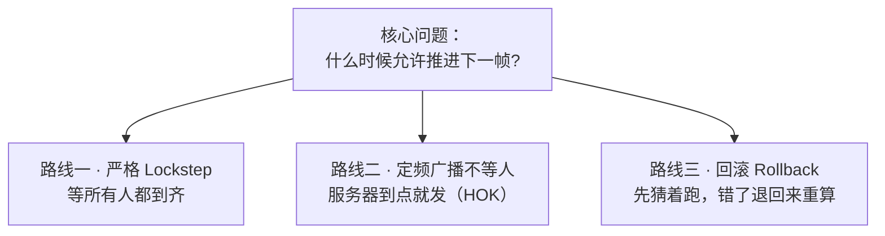

| 路线 | 推进条件 | 代表 | 一人卡顿的后果 |
|---|---|---|---|
| **严格 Lockstep** | 收齐所有人的输入 | 早期 RTS（星际、魔兽 3、帝国时代） | **全场一起停** |
| **定频广播 + 不等人** | 收到服务器本帧广播 | 现代 MOBA（含 HOK） | **只有他自己受损** |
| **回滚 Rollback** | 预测输入立即推进，错了回滚重算 | 格斗游戏（GGPO 及后继者） | 只有他自己画面跳 |

三条路线没有绝对优劣，只有**适配场景**的不同：玩家数量、单位规模、对延迟的敏感度、可容忍的状态快照成本，共同决定了该选哪一条。

> 本文将分三层次展开这个话题：**此处概览** → **2.4 节剖析三条路线的机制与代价**，**2.5 节聚焦动作/格斗游戏如何把这条路线推到极限** → **3.1 节用"丢包"这一具体场景验证它们的差异**。理解这条分野，是理解 HOK 全部设计取舍的钥匙。

---

## 第 2 章 帧同步的三块基石

帧同步能成立，依赖三条缺一不可的前提。任何一条被破坏，整场对局就会走向不一致。

### 2.1 基石一：定帧——把连续时间切成等长的格子

连续的时间无法同步，必须先**离散化**：把对局切成一个个等长的"逻辑帧"（Logic Frame / Tick）。

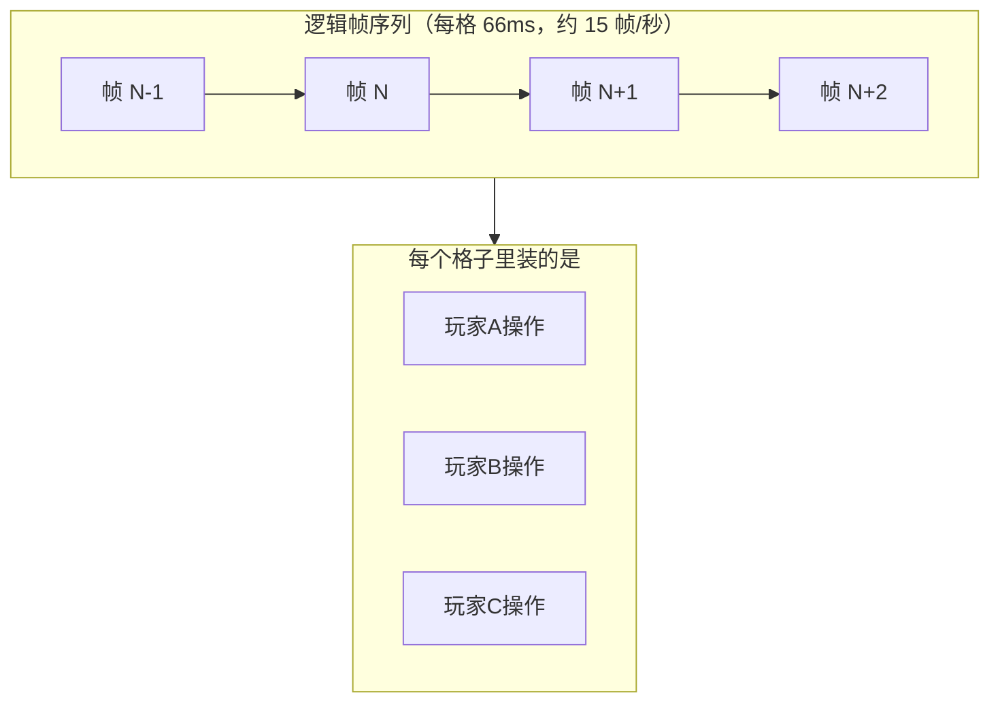

服务器以固定节奏（HOK 为约 15 帧/秒，即约 66 毫秒一帧）收集这段时间内所有玩家上报的操作，打包成"第 N 帧的输入集合"，广播给所有客户端。

客户端只有在**收到服务器广播的第 N 帧**之后，才被允许推进第 N 帧的逻辑。

> **这一步是帧同步的灵魂**：它把"什么时候算"从"我什么时候想算"变成"我什么时候拿到第 N 帧"。时间因此被统一，不再依赖任何人的本地时钟。

这里有一个极易被误解、却非常关键的点，必须在此澄清：

**服务器不会等待任何客户端。** 它按固定节奏广播，到点就发；谁的操作在这个周期里没上报到，这一帧的输入集合里就没有谁。反过来，客户端只依赖**服务器这一份广播**，并不需要分别去"等齐其他所有玩家"。

这与早期严格 Lockstep（必须收齐所有人的输入才允许推进下一帧）有本质区别。HOK 采用的是 **"定频广播 + 不等人"** 策略——它把一个可能全局化的故障，主动降级成了局部故障。这一点会在第 3.1 节展开。

### 2.2 基石二：确定性——同样的输入必须得到同样的输出

如果两台设备拿同样的输入却算出不同结果，同步立刻崩塌。这要求战斗逻辑是**确定性（Deterministic）**的。

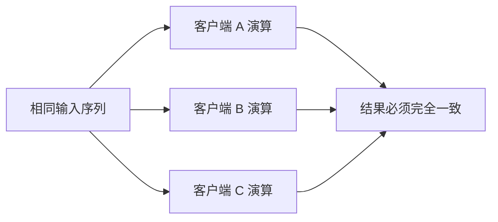

确定性的敌人比想象中多：

| 敌人 | 例子 | 通常的对策 |
|---|---|---|
| 浮点差异 | 不同 CPU / 编译器下 `float` 运算结果末位不同 | 全面改用**定点数** |
| 随机 | 各端随机数不一致 | 使用**可播种的同步随机源**，种子随帧下发 |
| 遍历顺序 | 字典/哈希表的遍历顺序不稳定 | 禁用或强制排序 |
| 时间依赖 | 逻辑里读了本地时钟 | 逻辑层禁用墙钟，只用逻辑帧号 |
| 多线程 | 线程调度顺序不确定 | 逻辑层单线程串行 |
| 帧率耦合 | 逻辑受渲染帧率影响 | 逻辑帧与渲染帧彻底解耦 |

HOK 的做法是把战斗逻辑整体放进一个**不依赖引擎的逻辑层**（C++ GameCore），从物理上隔绝上述风险：定点数、帧随机源、单线程串行、倍速用有理数（分子/分母）而非浮点表示——每一条都是为确定性服务。

### 2.3 基石三：广播输入，而非广播结果

第三条是前两条的自然推论：既然各端都能算出一样的结果，那网络上就**只传输入，不传结果**。

这带来一个非常漂亮的性质：**整场战斗的全部信息，就等于一串输入序列**。

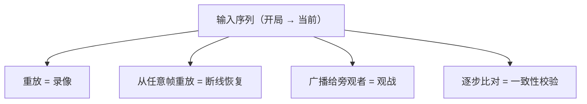

录像、断线重连、观战、反作弊——这四件事在帧同步下**共用同一套机制**。这是帧同步在工程上最大的红利，也是 HOK 把这套体系做厚的核心原因。

### 2.4 深入：Lockstep 家族谱系，以及 HOK 为什么这样选

第 1.5 节留下了那个关键问题：**什么时候允许推进下一帧？** 这里把它彻底展开。

#### 2.4.1 路线一：严格 Lockstep（Deterministic Lockstep）

最经典、也最严格的形态：**必须收齐所有人的输入，才允许推进下一帧**。

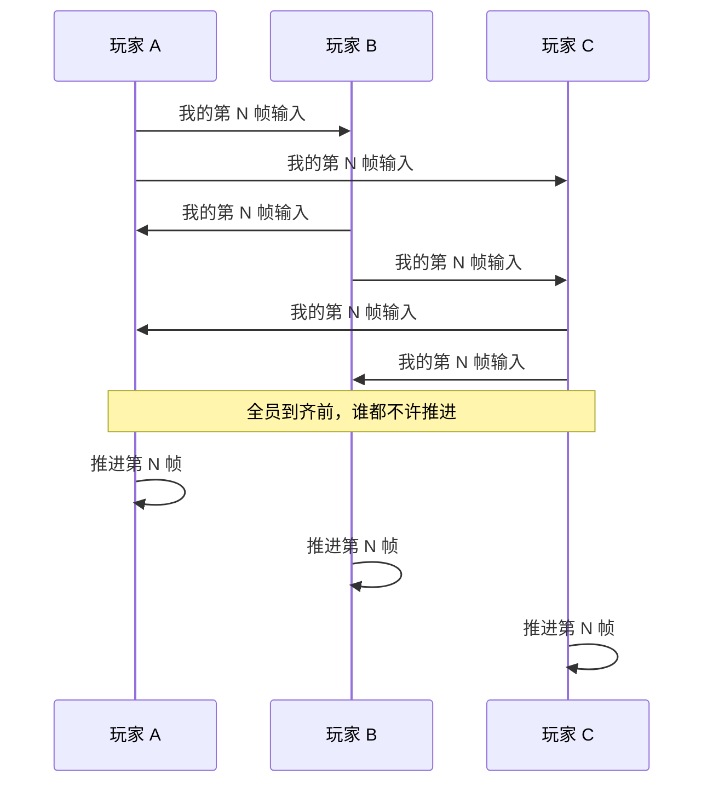

**代表作品**：星际争霸、魔兽争霸 3、帝国时代、命令与征服等早期 RTS。

这些游戏里有一个玩家都非常熟悉的现象：当某个玩家网络变差时，屏幕上会弹出"**某某玩家正在拖慢游戏**"这样的提示，然后**所有人的画面一起卡住**，直到那个人恢复或者被踢出。

这正是严格 Lockstep 的标志性特征——**木桶效应**：一帧的推进速度，取决于最慢的那个人。

它的优点也很实在：

| 优点 | 说明 |
|---|---|
| 实现简单 | 不需要预测、不需要回滚、不需要快照 |
| 天然一致 | 既然大家都等到齐才跑，自然不会因网络产生分歧 |
| 无回滚抖动 | 画面永远不会"往回跳" |

#### 2.4.2 严格 Lockstep 的补丁：用延迟换流畅

木桶效应太伤体验，于是有了经典的缓解手段——**主动增加输入延迟（Delay-based）**：

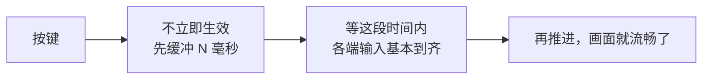

逻辑是：既然抖动会导致卡顿，那就**人为设定一个缓冲窗口**（比如 100 毫秒），在这个窗口内等齐各端输入。只要抖动幅度小于缓冲窗口，画面就能保持流畅。

代价也很直接：**所有人的操作都变迟钝了**。你按下技能，要等 100 毫秒才有反应——而这 100 毫秒对所有人一视同仁，哪怕你网络再好。

> 这在格斗游戏领域尤其致命（帧级精确的输入要求），也正是后来 Rollback 方案诞生的直接动因。

#### 2.4.3 路线二：定频广播 + 不等人（HOK 采用）

HOK 走的是完全不同的第二条路。它有一个严格 Lockstep 时代不存在的角色——**Relay 中转服务器**。

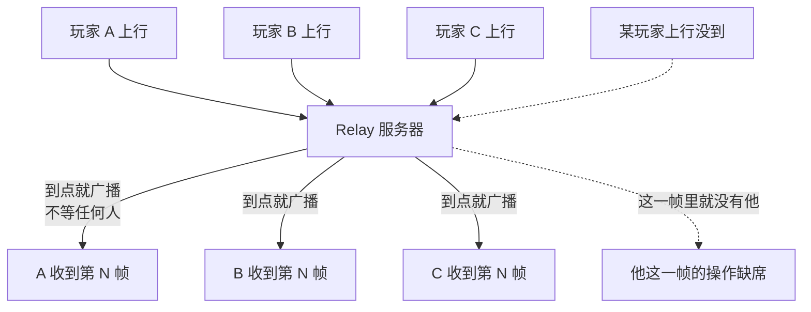

关键变化有三点：

1. **广播权在服务器**：客户端之间不再互相等待，大家都只依赖服务器这一份广播
2. **服务器不等人**：到点就发，谁的操作没上报，这一帧里就没有谁
3. **故障被局部化**：任何一个人的网络问题，都只影响他自己

这个模型有时也被称为**时间桶（Time Bucket）**模型——服务器按固定节奏把一段时间内的输入装进一个"桶"里，然后广播出去。HOK 协议注释里"relaysvr 12-15 驱动帧下发"正是这个节奏的直接体现。

代价是：丢包者本人要承担全部损失（要么操作进不去，要么自己画面卡住）。这一点在第 3.1 节详述。

#### 2.4.4 路线三：回滚（Rollback）

第三条路最为激进，也最精巧：**不等待、不缓冲，直接猜着跑**。

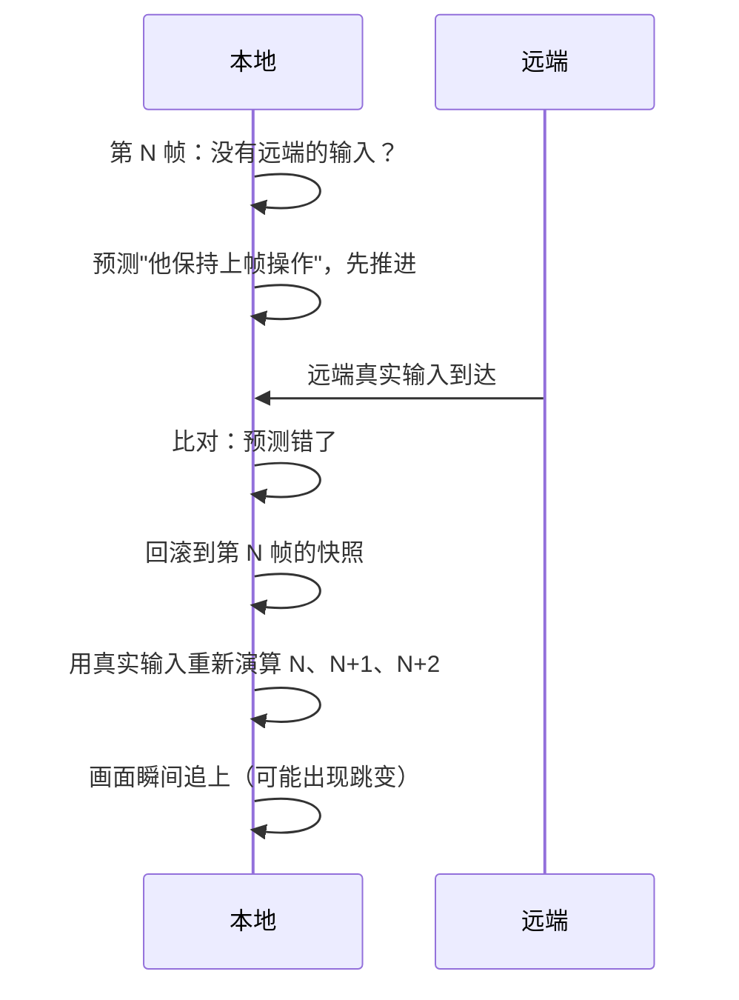

核心机制是：**预测 → 推进 → 收到真值 → 若不符则回滚到快照 → 用真值重算**。由于预测通常很准（多数时候玩家操作是连续的），回滚很少触发，因此延迟感极低。

**代表**：GGPO（Good Game Peace Out）是这套方案的开创者，最初为格斗游戏设计；如今《街霸》《罪恶装备》《真人快打》等主流格斗游戏，以及部分体育/竞技类游戏，都采用了 Rollback 或其变体。

为什么格斗游戏特别适合 Rollback：

| 条件 | 格斗游戏的情况 |
|---|---|
| 玩家数 | 只有 2 人 |
| 状态规模 | 只有 2 个角色 + 少量判定框，**快照极小** |
| 回滚成本 | 重算几帧几乎免费 |
| 延迟敏感度 | 极高（帧级判定），不能容忍延迟缓冲 |

反过来看，这四条在 MOBA 里**恰好全部相反**。

> 回滚的完整机制、它为什么会被动作与格斗游戏"逼出来"、以及这条技术路线的演进脉络，见 **2.5 节**。

#### 2.4.5 三条路线的总对照

| | 严格 Lockstep | 定频广播不等人 | 回滚 Rollback |
|---|---|---|---|
| **推进条件** | 全员到齐 | 收到服务器本帧广播 | 预测后立即推进 |
| **是否需要服务器** | 否（P2P 即可） | **是（Relay）** | 否（P2P 即可） |
| **一人卡顿的影响** | 全场停摆 | 仅自己受损 | 仅自己画面跳 |
| **操作延迟** | 取决于最慢者 | 取决于自己到服务器的链路 | **极低**（几乎无感） |
| **是否需要状态快照** | 不需要 | 不需要 | **需要**（每帧一份） |
| **实现复杂度** | 低 | 中 | **高** |
| **代表** | 星际、魔兽 3 | **HOK 等现代 MOBA** | GGPO、现代格斗 |

#### 2.4.6 为什么 HOK 选了路线二

把 MOBA 的约束条件摆出来，答案就很清楚了：

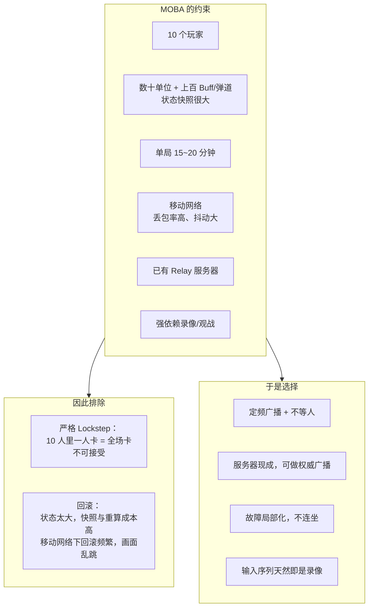

几个具体的判断依据：

- **10 个玩家的规模**让严格 Lockstep 的风险被放大十倍。只要有一人网络波动，另外九人就要陪着卡——这在移动网络下几乎必然发生。
- **状态规模**让回滚不划算。格斗游戏回滚只需重算两个角色；MOBA 要重算十个英雄、几十个小兵野怪、上百个持续效果与飞行道具，成本高到不可接受。
- **移动网络的丢包率**远超有线网络。在丢包率较高的环境里，回滚会频繁触发，表现为持续的画面跳变，反而比"偶尔卡一下"更难受。
- **Relay 服务器已经存在**（无论 CC 还是 CS 模式都需要一个中转节点），让它承担"定频广播"这个职责是顺理成章的，不需要额外的基础设施。
- **输入序列即录像**这条红利（2.3 节）在"输入广播"模型下天然成立，而回滚模型下由于存在预测与重算，录像语义会复杂得多。

> **一句话总结**：严格 Lockstep 太脆弱，Rollback 太昂贵，而"定频广播 + 不等人"在 MOBA 的约束下是那个**刚刚好的解**——它用"丢包者自己受损"这一可接受代价，换来了"故障不扩散"与"实现可控"两项关键收益。

### 2.5 拓展：动作游戏如何把 Lockstep 逼到极限

三条路线里，回滚最复杂也最精巧。它之所以会被发明出来，是因为有一类游戏把"操作延迟"的容忍度压到了人类感知的极限——**动作与格斗游戏**。

理解这一类游戏，能反过来让我们更清楚地看到 MOBA 的取舍为什么成立。

#### 2.5.1 四项极端约束

| 约束 | 典型情况 | 为什么致命 |
|---|---|---|
| **运行帧率** | 60 帧/秒，一帧仅约 16.7 毫秒 | 缓冲 6 帧就是 100 毫秒 |
| **判定精度** | 帧级：命中框与受击框逐帧比对 | 差一帧，结果就完全不同 |
| **输入窗口** | 目押、连段的容错常只有 3~5 帧（约 50~80 毫秒） | 延迟会直接打断连段 |
| **人类反应** | 约 200 毫秒 | 网络延迟占比越高，手感越"不听话" |

把这些数字放在一起看，问题就很直观了：

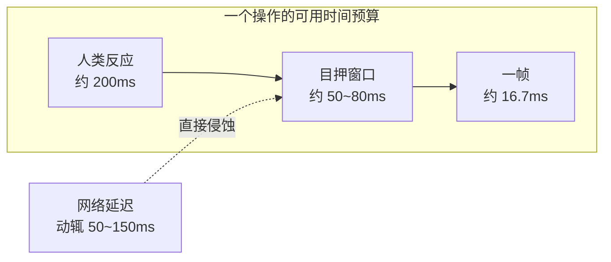

**网络延迟与"目押窗口"是同一个量级的。** 这就解释了为什么动作游戏不能沿用 RTS 那套思路。

#### 2.5.2 为什么"延迟换流畅"在格斗里是死路

回到 2.4.2 的"延迟型"补丁：设一个缓冲窗口吸收抖动，代价是所有人的操作都变迟钝。

- 对 **RTS**：完全可接受。点击之后单位要走一段路，几十毫秒的延迟淹没在动画里
- 对 **格斗**：不可接受。设 100 毫秒缓冲 ≈ 6 帧，而**一个目押窗口本身才 3~5 帧**

也就是说，缓冲还没等来网络输入，玩家的操作窗口就已经过去了。表现是：连段接不上、确反打不出来、玩家觉得"我的角色不听话"。

这正是格斗游戏联机长期以来口碑糟糕的技术根因，也是回滚方案诞生的**直接动因**。

#### 2.5.3 回滚的完整机制：四个要件

回滚能成立，依赖四件事同时就位：

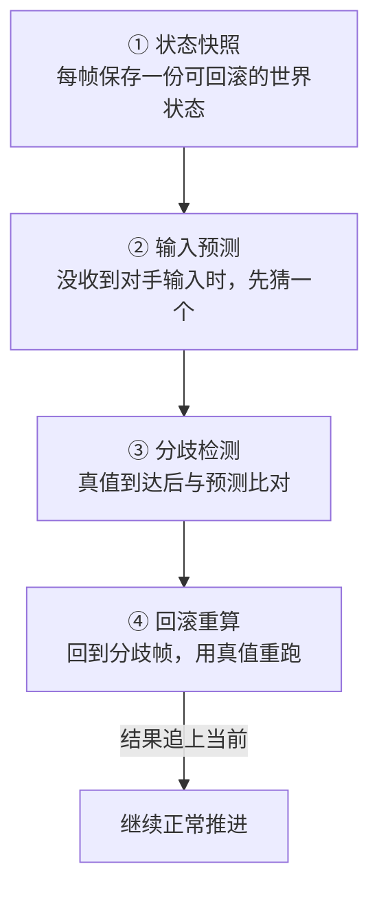

一次典型的回滚过程：

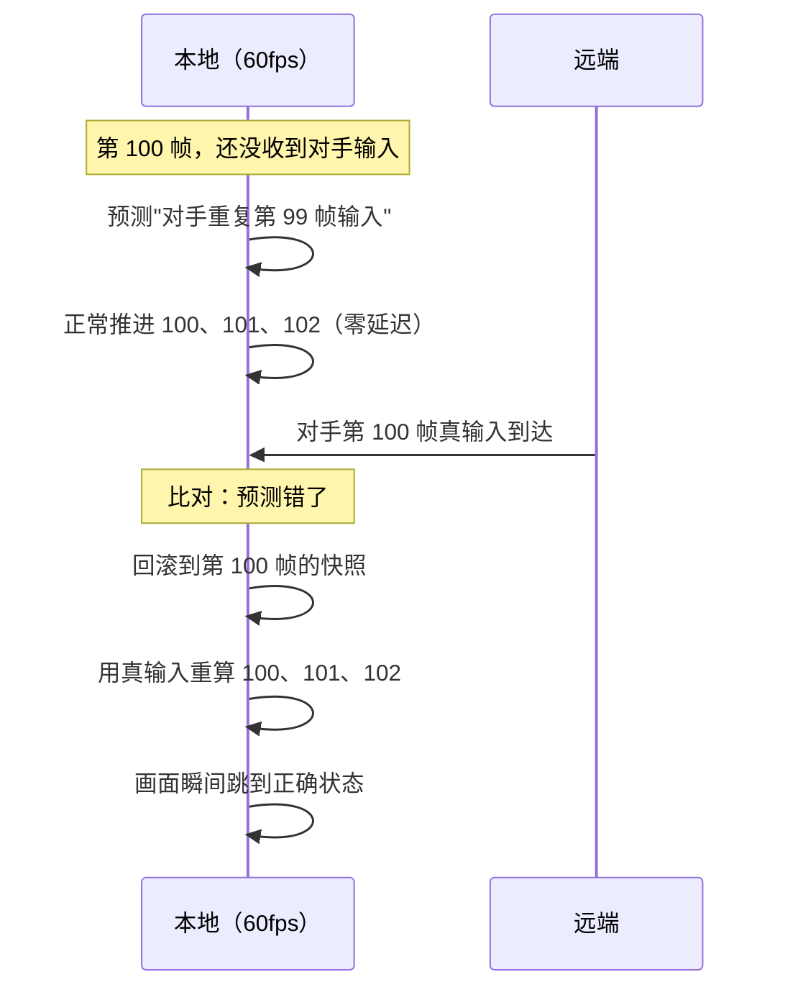

关键收益是：**本地推进永远是零延迟的**。玩家按键立刻看到反馈，网络只影响"事后要不要修正"。

而预测之所以经常是对的，是因为格斗游戏的输入高度连续——按住一个方向、连续按键、保持防御，相邻帧的输入多数时候完全一致。

#### 2.5.4 回滚深度：一道不可逾越的墙

回滚不能无限深。通常实现会设定一个**回滚深度上限**（一般几帧到十几帧）：

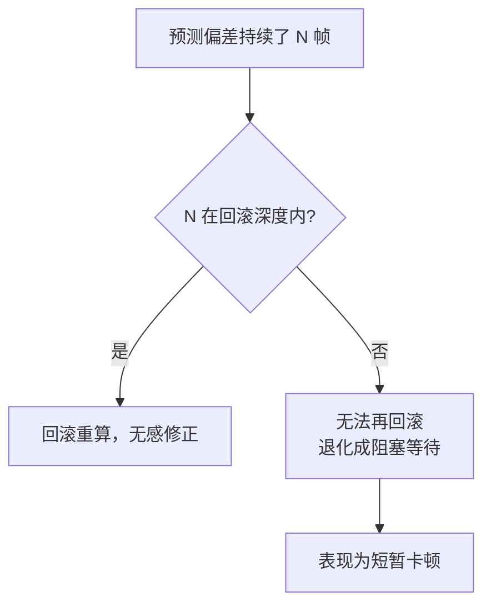

一旦网络差到超过回滚深度，回滚就退化成了等待——**回滚并没有消灭木桶效应，只是把它推迟到了更糟的网络条件下才暴露**。这是理解回滚局限性的关键。

#### 2.5.5 回滚的三个棘手问题

**一、视觉跳变（Rollback Artifact）**

回滚重算后，画面会**瞬间从一个状态跳到另一个状态**。角色可能突然瞬移、特效突然消失、一个已经播出的攻击被"收回"。这是回滚最直观的副作用。

缓解手段：限制回滚深度、对画面变化做平滑、只在真正分歧时才回滚。

**二、音频无法回滚**

声音一旦播出就收不回来。回滚时会遇到：该响的音效没响、不该响的响了、同一个音效被播了两次。

多数做法是让音频**不参与回滚**（按预测时的状态播放），代价是偶尔音画不同步。这是回滚方案里公认最难处理干净的部分。

**三、对确定性的要求更严苛**

回滚意味着同一段帧要被**反复重算多次**。任何浮点差异、随机不一致、遍历顺序不稳定，都会在重算中暴露成"回滚后状态对不上"——比不回滚的帧同步更容易出问题。

因此采用回滚的项目，往往要在定点数、确定性随机、状态序列化上投入更多。

#### 2.5.6 现代方案：回滚 + 小基础延迟（混合）

纯回滚（零基础延迟）有一个现实问题：**网络只要轻微抖动就会触发回滚**，而每次回滚都有跳变与重算成本。

现代格斗游戏的通行做法是**混合方案**——设一个极小的基础延迟（通常 2~3 帧）：

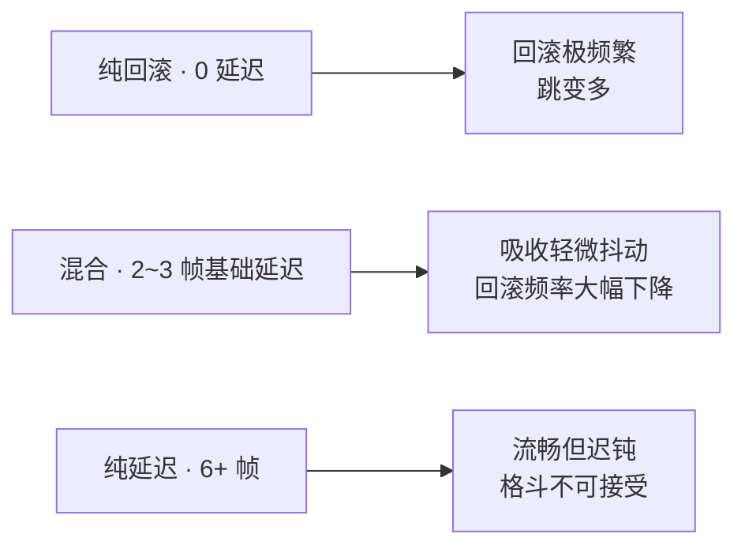

用几十毫秒的延迟，换回滚频率的大幅下降——这在格斗的容忍范围内，是个性价比很高的折中。

#### 2.5.7 技术演进脉络

| 时期 | 主流方案 | 代表 |
|---|---|---|
| 1990s | **严格 Lockstep** | 星际、魔兽 3、帝国时代等 RTS |
| 2000s | **延迟型 Lockstep**（延迟换流畅） | 早期格斗游戏联机 |
| 约 2006 起 | **回滚（Rollback）** 被提出并实践 | GGPO（Good Game Peace Out）及后继者 |
| 2010s 至今 | **回滚 + 小基础延迟** 成为动作/格斗标配 | 主流格斗游戏 |
| 同期 | **定频广播 + 不等人** | 现代 MOBA（含 HOK） |

注意最后两行是**并行**的：格斗游戏走向回滚，MOBA 走向定频广播，**两者不是替代关系，而是针对不同约束各自收敛**。

#### 2.5.8 三条路线的"延迟—复杂度"权衡

| | 操作延迟 | 实现复杂度 | 需要快照 | 适合 |
|---|---|---|---|---|
| 严格 Lockstep | 取决于最慢者 | 低 | 否 | RTS、回合策略 |
| 延迟型 | 固定较高（100ms 级） | 低 | 否 | 对延迟不敏感的品类 |
| **回滚** | **接近零** | **高** | **是** | 格斗、动作、高精度竞技 |
| **定频广播 + 不等人** | 取决于自身链路 | 中 | 否 | MOBA、多人战场 |

可以看到，**回滚是唯一能同时做到"低延迟"与"故障局部化"的方案，代价是复杂度与快照成本**。

#### 2.5.9 回到 HOK：为什么 MOBA 不必走到这一步

把回滚的四个前提摆出来，再看 MOBA：

| 回滚的前提 | 格斗游戏 | MOBA（HOK） |
|---|---|---|
| 参与人数 | 2 人 | **10 人**（要预测 9 路输入） |
| 状态规模 | 2 个角色 + 少量判定框 | **数十单位 + 上百持续效果**，快照昂贵 |
| 每帧重算成本 | 几乎免费 | **很高** |
| 网络环境 | 多为稳定有线/主机网络 | **移动网络，丢包与抖动常态化** |

最后一条尤其关键：在移动网络的高抖动下，回滚会被**频繁触发**，而每一次触发都伴随画面跳变。结果是"偶尔卡一下"变成了"画面持续抽动"——体验反而更差。

所以 HOK 停留在"定频广播 + 不等人"，并不是技术落后，而是**在它的约束集合下的最优收敛点**。回滚解决的是"2 人、极小状态、极低延迟容忍"的问题；MOBA 面对的是"10 人、大状态、高丢包"的问题——**问题的形状不同，最优解自然不同**。

> **这一节的意义在于**：理解回滚之后再看 HOK 的取舍，会发现它并非"没有做优化"，而是**清醒地知道自己不需要付出回滚的代价**。工程上最难的不是知道某个方案先进，而是知道某个方案**不适合自己**。

---

## 第 3 章 帧同步的三个天敌

基石立住了，接下来是现实世界。帧同步在工程上有三个必须正面应对的敌人。

### 3.1 天敌一：丢包

推进第 N 帧的前提是拿到第 N 帧。可 UDP 是**会丢的**——而丢包在上下行两个方向上造成的损失，**完全不同，且都不对称**。

#### 上行丢包：损失的是"我的操作"

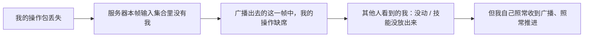

服务器不会为了等我而停下：到了广播时刻，谁的操作没到，这一帧里就没有谁。

后果是**我的操作迟到或彻底缺失**——我按了技能却没释放，推了摇杆人却没动。这在 MOBA 里可能直接决定一次团战的胜负。

但影响范围**只有我自己**：其他人照常收到广播、照常推进，他们只是"看到那个人卡了一下"。

#### 下行丢包：损失的是"我的推进"


我收不到这一帧，就只能卡在原地等（靠冗余补回、主动补发或追帧）。同样，**其他人完全不受影响**。

#### 关键：代价是局部的，不是全局停摆

这一点常被误传，值得单独强调。

在**严格 Lockstep** 模型下，确实存在"一人卡顿、全员停摆"的木桶效应——所有客户端必须收齐所有人的输入才允许推进。但 HOK 采用的不是这种模型：

| | 严格 Lockstep | HOK（定频广播 + 不等人） |
|---|---|---|
| 服务器是否等待慢的客户端 | 是 | **否** |
| 一人上行丢包 | 全员等待 | 只有他自己丢操作 |
| 一人下行丢包 | 全员等待 | 只有他自己卡住 |
| 故障影响域 | **全局** | **局部** |

这是一个明确的设计选择：**把潜在的全局故障，主动降级为局部故障。** 代价是"丢包者本人的体验会明显变差"，收益是"一个人的网络问题不会拖累其余九个人的对局"。

> 这正是 2.4 节剖析的 **"定频广播 + 不等人"** 路线的直接体现。它区别于星际、魔兽 3 那一代 RTS 所采用的严格 Lockstep——在那里，一人卡顿就是全场停摆。

#### 但对自己而言，代价依然严重

局部化不等于可以忽视。对丢包者本人来说：

- 上行丢包 = 我的操作不生效 = 我在这场对局里"手残"
- 下行丢包 = 我的画面停滞 = 我完全无法有效操作

任意一种持续超过几百毫秒，对玩家而言就是"这局没法打了"。

所以仍然需要一整套兜底机制——只不过这套机制的目标**不是"让大家等我"**，而是**"让丢包的那个客户端尽快自己把缺的内容补回来"**。这正是第 10、16、17 章要展开的内容。

### 3.2 天敌二：延迟与抖动

即使不丢包，网络延迟也在持续存在，而且**抖动（Jitter）比平均值更致命**：

- 平均延迟 50ms：稳定，可以通过缓冲吸收
- 平均 50ms 但抖动 0~300ms：帧会忽快忽慢，表现为"一卡一卡"

帧同步要做的，是在延迟与流畅之间找平衡：缓冲太少则抖动直接暴露为卡顿，缓冲太多则操作延迟变大。

### 3.3 天敌三：不同步（Desync）

最难缠的一个。前两个天敌至少"看得见"，不同步是**静默发生的**：

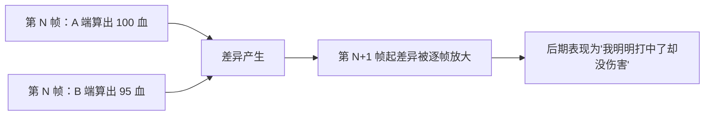

一旦某个瞬间的浮点、随机或顺序出现分歧，差异会被后续每一帧**持续放大**，最终表现为各种"灵异现象"，且**无法自愈**——因为没有任何权威状态来纠正。

所以帧同步必须有**主动的一致性检测**与**定位手段**，而不是等玩家投诉。

---

## 第 4 章 HOK 的答案速览

面对这三个天敌，HOK 给出的整体答案可以浓缩成一张图：

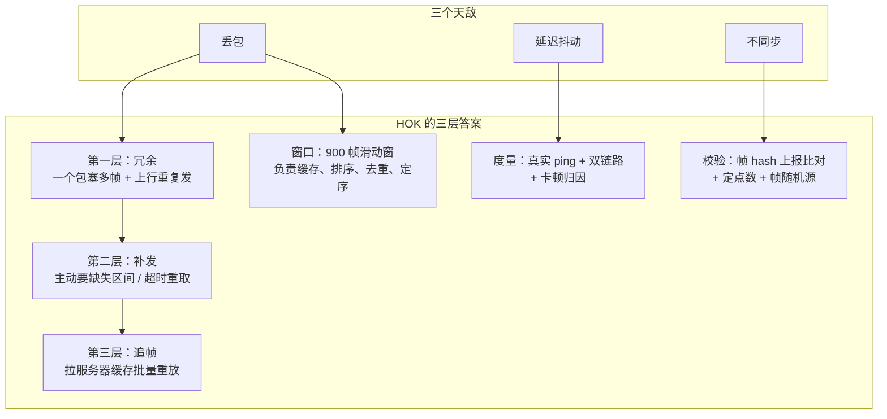

用一句话概括全文：

> **HOK 的帧同步 = 「服务器定帧汇总 + 三层冗余抗丢包 + 900 帧滑动窗口定序 + 本地逻辑层确定性模拟 + 逻辑与表现彻底解耦」**
>
> 其中"冗余 / 补发 / 追帧"解决**收得全**，"定点数 / 帧随机 / hash 校验"解决**算得一样**，"逻辑立即交付 + 表现延迟跟随"解决**不互相拖累**。

---

第二篇起，我们进入 HOK 的真实结构。

---

# 第二篇 架构篇：HOK 长什么样

## 第 5 章 三层分工

### 5.1 一张全景图

HOK 的对局架构清晰地分成三层，每层的职责边界非常明确：

```mermaid
flowchart TB
    subgraph CSHARP["表现层 · C# / Unity"]
        direction TB
        C1["输入采集<br/>摇杆、技能按钮"]
        C2["网络通信<br/>收发包、协议编解码"]
        C3["表现播放<br/>特效、音效、UI、飘字"]
        C4["资源与场景"]
    end
    
    subgraph CPP["逻辑层 · C++ GameCore"]
        direction TB
        P1["确定性战斗模拟<br/>位移 / 技能 / 伤害 / AI / Buff"]
        P2["帧同步器<br/>帧号、帧推进节奏"]
        P3["帧随机数 · 定点数运算"]
    end
    
    subgraph SVR["Relay 服务器"]
        direction TB
        S1["帧号分配"]
        S2["命令汇总与去重"]
        S3["定频广播"]
        S4["历史帧缓存"]
        S5["策略参数下发"]
    end
    
    C1 -->|"帧命令上行"| SVR
    SVR -->|"SCID_FRAPBOOTINFO 1035"| C2
    C2 -->|"解包后交付"| CPP
    CPP -->|"表现事件回传"| C3
```

### 5.2 三层的具体职责

| 层 | 语言 | 做什么 | **不做什么** |
|---|---|---|---|
| **表现层** | C# / Unity | 采集输入、收发网络包、协议编解码、播放表现、管理资源 | **不做任何战斗判断** |
| **逻辑层** | C++（GameCore） | 确定性战斗模拟、帧同步节奏控制、随机数与定点数运算 | 不碰引擎、不做表现、不收网络包 |
| **Relay 服务器** | — | 分配帧号、汇总去重各端命令、定频广播、缓存历史帧、下发策略参数 | 不做战斗逻辑（CC 模式下） |

### 5.3 为什么要让 C++ 独立承担逻辑

把战斗逻辑放进独立的 C++ 层，收益不止于性能：

```mermaid
flowchart LR
    R1["确定性保障<br/>脱离引擎浮点与调度"] --> M["C++ 独立逻辑层"]
    R2["不依赖引擎<br/>可脱离 Unity 单独跑"] --> M
    R3["服务器可复用同一份代码<br/>CC / CS 模式共享"] --> M
    R4["性能可控<br/>大批量单位演算"] --> M
```

其中"不依赖引擎"这一条尤为关键：它意味着**同一份逻辑代码既能跑在手机上，也能跑在服务器上**——这正是第 20 章要讲的 CS 模式能够成立的前提。

> **一个重要的边界观察**：C# 层虽然"懂协议""懂表现"，但对战斗一无所知。它收到一帧数据后做的全部事情，就是把里面的命令**原封不动地递给 C++**，然后等 C++ 告诉它"该演什么"。这个边界的窄化，是整套架构可维护的根本。

---

## 第 6 章 逻辑与表现的分界

这一章是全文最关键的部分。理解了它，后面所有机制都会变得顺理成章。

### 6.1 一个命令的两条命运

当客户端从帧数据里解出一条命令（比如"玩家 B 向 45 度方向释放技能"），这条命令会**同时走向两条不同的路**：

```mermaid
flowchart TB
    CMD["解出一条帧命令"] --> Q{"分流"}
    Q -->|"路径一 · 立即"| LOGIC["交付逻辑层<br/>OnReceive"]
    Q -->|"路径二 · 排队"| QUEUE["进入表现命令队列"]
    
    LOGIC --> PIPE["写入 C++ 共享缓冲区<br/>携带帧号与玩家标识"]
    PIPE --> WAIT["C++ 在对应帧执行"]
    
    QUEUE --> CHK{"当前帧号已追上<br/>该命令的目标帧?"}
    CHK -->|"否"| QUEUE
    CHK -->|"是"| SHOW["执行表现<br/>ExecLocal"]
```

对应的两个动作：

| 动作 | 时机 | 去向 | 语义 |
|---|---|---|---|
| **`OnReceive`** | 解出命令的**瞬间**，立即执行 | 写入 C++ 共享缓冲区 | **这是逻辑层的入口**：命令必须在正确的帧被演算 |
| **`ExecLocal`** | 等到本地帧号**追上**该命令所属帧，才执行 | C# 表现层 | **这是表现层的入口**：表现可以迟到，可以插值 |

> ⚠️ **先打个预防针**：看完这张图很容易以为"表现主要靠第二条路"。**事实正好相反**——路径二在绝大多数命令里是空的。你看到的技能特效、伤害飘字、死亡动画，走的是**第三条路**：由 C++ 演算完后主动推回来。详见 6.4 节。这里先只讲"分流"这件事本身。

### 6.2 为什么要拆成两条路

因为**逻辑和表现对"时间"的要求完全相反**：

| | 逻辑 | 表现 |
|---|---|---|
| 对时间的要求 | **必须**精确落在第 N 帧 | 大致跟上即可，允许晚一点 |
| 能否等待 | 不能等，等了就错过帧 | 可以等，等待期间插值平滑 |
| 能否乱序 | 绝不能，乱序即不同步 | 无所谓 |
| 单位 | 逻辑帧（固定 66ms） | 渲染帧（随设备 16~33ms 波动） |
| 驱动者 | 服务器定帧 + 本地共享缓冲 | 本地帧号 + 渲染循环 |

如果表现跟着逻辑"同步阻塞"，那么一次网络抖动就会让画面直接冻住；而拆开之后，逻辑照常按帧推进，表现可以自行插值、平滑追赶——**卡顿被隔离在表现侧，不会污染逻辑**。

### 6.3 帧号由谁说了算

这里有一个容易搞反的细节：**本地帧号不是 C# 自己累加的**。

```mermaid
sequenceDiagram
    participant S as 服务器
    participant C as C# 表现层
    participant P as C++ 逻辑层
    
    S->>C: 下发第 N 帧输入
    C->>P: 逐条交付命令
    C->>P: 授权推进第 N 帧
    P->>P: 执行第 N 帧模拟
    P->>C: 回报"当前逻辑帧 = N"
    C->>C: 更新本地帧号 CurFrameNum = N
    C->>C: 队列中帧号 <= N 的命令 → 执行表现
```

流程是：

1. C# 收齐一帧的命令，全部交付给 C++
2. C# 调用"授权推进第 N 帧"的接口（一帧内**所有命令处理完之后**才调用，顺序不能颠倒）
3. C++ 真正执行第 N 帧模拟
4. C++ 主动回报"当前逻辑帧号 = N"
5. C# 才把本地帧号更新到 N，并放行对应的表现命令

> **理解要点**：C# 的帧号是**被 C++ 拖着走的**。C# 只负责"喂料"和"授权"，跑多快由 C++ 说了算。这就是为什么表现能天然与逻辑保持同步——它们本来就是同一个帧号驱动的。

### 6.4 两种表现：命令表现 vs 结果表现

6.1 节留下了一个必然产生的疑问：既然命令分了两条路，那我们看到的**技能特效、伤害飘字、死亡动画**，究竟是哪条路产生的？

答案是：**都不是第二条路**。它们由 C++ 主动推回来。

#### 6.4.1 事实：多数命令的表现方法是空的

翻遍各类帧命令的实现会发现，绝大多数命令的 `ExecLocal` **方法体是空的**。少数非空的，做的事也高度一致：

| 非空的例子 | 实际做的事 |
|---|---|
| 设置攻击目标模式 | 移除"等待服务器确认"的超时定时器 |
| 设置补刀 / 攻击机关模式 | 同上 |
| 设置局内聊天输入使能 | 同步聊天输入框的可用状态 |

**没有一个是负责"技能特效、伤害飘字、死亡动画"这类战斗表现的。**

#### 6.4.2 战斗表现走的是第三条路

```mermaid
flowchart TB
    A["C++ 执行完第 N 帧"] --> B["产生'结果'事件<br/>命中 / 伤害 / 死亡 / 击退 / 升级 / 获得金币"]
    B --> C["写入反向共享缓冲区"]
    C --> D["C# 每帧批量取回"]
    D --> E["播放特效 / 飘字 / 音效 / UI"]
```

请注意这里的因果链：**不是"收到命令 → 播放表现"，而是"演算出结果 → 播放表现"**。

这个区别至关重要。当 C# 收到"玩家 B 释放技能"这条命令时，它并不知道会发生什么——技能会不会命中？伤害多少？目标会不会死？**这些都只有 C++ 演算完才知道**。所以战斗表现只能等 C++ 通知。

#### 6.4.3 执行层：AGE 演出系统

既然战斗表现由 C++ 触发、C# 执行，那 C# 这一层究竟是怎么"演"的？答案是 **AGE 演出系统**。

AGE 是 HOK 的**表现时间轴系统**：一次技能或一段演出被编排成一条时间轴，上面挂着若干"持续段"与"瞬时事件"——播动画、触发粒子、震屏、改材质、切镜头、刷新 HUD……

代码里那数十个 `AGEWrapXxxDuration`（播放动画、触发粒子、镜头震动、修改材质参数、小地图图标、HUD 控制……）就是这套系统的**积木**：

```mermaid
flowchart TB
    subgraph CPP["决策层 · C++<br/>持有 AGE 时间轴与帧同步时钟"]
        C1["推进 AGE 时间轴"]
        C2["进入某个持续段 → 发 Enter 指令"]
        C3["离开该段 → 发 Leave 指令"]
        C4["变速 → 发 SpeedModified 指令"]
    end
    
    subgraph PIPE["传输层 · cpp2cs 共享内存"]
        P1["NtfAgePlayAnimDurEnter / Leave / SpeedModified"]
        P2["NtfAgeTriggerParticleEnter / Leave"]
        P3["CameraShakeDurationEnter"]
        P4["NtfAgeUseSkillDurationEnter / Leave"]
    end
    
    subgraph EXEC["执行层 · C# AGE_Wrapper"]
        E1["AGEWrapPlayAnimDuration"]
        E2["AGEWrapTriggerParticle"]
        E3["AGEWrapperCameraShakeDuration"]
        E4["AGEWrapSkillHudCtrlTick … 数十种"]
    end
    
    CPP --> PIPE --> EXEC
    EXEC --> R["落成 Unity 行为<br/>挂粒子 / 播 Animator / 改材质 / 震屏 / 刷 HUD"]
```

有几处细节可以佐证"控制权在 C++ 手里"：

- 每个 wrapper 的**标识由逻辑层定义**：id = 逻辑层的演出序号 + 类型编号，而类型枚举本身是由逻辑层生成的
- wrapper 内部记录的序号，代码注释直接写着"**逻辑层对应的 age seqNum**"
- wrapper 的**创建、结束、调速**全部来自 C++ 指令；C# 只负责实例化、按帧推进，直到收到结束指令
- **局内不存在**"C# 读取演出文件、自行按时间轴播放"的路径

> **因此"AGE_Wrapper 里有大量 C# 代码"与"表现由 C++ 通知触发"并不矛盾。** 前者说明**表现的执行很重**（种类极多：粒子、动画、材质、镜头、光束、HUD、小地图……），后者说明**演什么、何时演由 C++ 决定**。代码量反映的是**执行复杂度**，控制权仍在逻辑层。

两点补充：

- **局外场景**（选将界面的技能预览、部分玩法的展示、编辑器）确实存在 C# 自行加载演出文件播放的路径，那与局内战斗是**两套东西**，不要混淆。
- 另有一条**反向路径**：剧情过场中，C# 可以下达指令让 C++ 播放指定的 AGE 演出。但即便如此，真正推进时间轴的仍是 C++ 的演出运行时，C# 只是说"播这个"。

#### 6.4.4 两种表现的分工

| | 命令表现（`ExecLocal`） | 结果表现（C++ 事件） |
|---|---|---|
| 表达什么 | "我按了什么" | **"发生了什么"** |
| 例子 | 技能指示器、设置类开关的 UI 同步、超时定时器清理 | 命中特效、伤害飘字、死亡动画、击退、音效 |
| 何时播放 | 本地帧号追上命令的目标帧 | C++ 演算完该帧并推送 |
| 是否依赖演算结果 | 不依赖 | **完全依赖** |
| 在 HOK 中的占比 | **很小，多数命令为空** | **绝大部分战斗表现** |
| 由谁执行 | C# 直接执行 | C# 通过 AGE 演出系统执行 |

#### 6.4.5 一个佐证：连技能指示器都被挪走了

代码里有一处耐人寻味的改动痕迹：早期版本中，"技能指示器的显示/关闭"是在命令的表现方法里做的，后来被**挪到了玩家输入的地方**——玩家一按键，指示器立刻本地响应，**根本不等帧回来**。

这正是"预表现"的思路：既然指示器显不显示并不依赖演算结果，就没必要绕一圈等服务器。

于是形成一条清晰的分界线：

```mermaid
flowchart LR
    A["依赖演算结果的表现<br/>伤害/命中/死亡"] --> B["老实等 C++ 通知"]
    C["不依赖演算结果的表现<br/>指示器/按钮反馈"] --> D["按键即本地响应<br/>不等帧"]
```

#### 6.4.6 这个设计带来的好处

- **职责清晰**：逻辑层定义"发生了什么"，表现层决定"长什么样"。逻辑不知道特效长什么样，表现不知道伤害怎么算
- **天然一致**：表现由演算结果驱动，十台设备演算一致 → 表现自动一致，不会出现"我以为打中了其实没打中"
- **便于扩展**：换皮肤、改特效，只需调整表现层对事件的响应，逻辑层零改动

---

## 第 7 章 一帧的生命周期

现在把视角拉到最高：客户端每一个渲染帧里，七件事严格按序发生。

### 7.1 主循环七阶段

```mermaid
flowchart TB
    S1["① 输入采集<br/>玩家操作 → 造命令 → 立即上行"]
    S2["② 网络接收<br/>抽干所有到达的包 → 解包 → 分发 → 交付逻辑层"]
    S3["③ 帧窗口维护<br/>扫描空洞 → 发补帧请求 → 卡顿统计"]
    S4["④ 逻辑推进<br/>驱动 C++ 执行本帧模拟"]
    S5["⑤ 反向通知<br/>取回 C++ 产生的表现事件并分发"]
    S6["⑥ CS 模式流（可选）"]
    S7["⑦ 帧同步器推进<br/>放行到期表现命令 → ping / 延迟 / 策略"]
    
    S1 --> S2 --> S3 --> S4 --> S5 --> S6 --> S7
    S7 -.->|"下一帧"| S1
```

各阶段的要点：

| 阶段 | 关键约束 |
|---|---|
| ① 输入采集 | 只在战斗中产生的输入才有效；非战斗状态直接丢弃 |
| ② 网络接收 | **必须循环抽干**，不能只读一个包，否则队列积压 |
| ③ 帧窗口维护 | 仅在 CC 模式执行；期间若正在追帧则跳过补发判定 |
| ④ 逻辑推进 | 加载中不推进 |
| ⑤ 反向通知 | **有单帧上限**，超量留到下一帧，避免一次性处理造成卡顿 |
| ⑥ CS 流 | 仅 CS 模式 |
| ⑦ 帧同步器 | 表现命令在这里被放行；同时做质量统计与策略决策 |

### 7.2 发包在最后

一个容易忽略但很重要的设计：**一帧内的所有发包都统一放在帧末**（LateUpdate 阶段）执行。

```mermaid
flowchart LR
    U["本帧产生的输入"] --> Q["发送队列"]
    R["冗余重发定时器到期"] --> Q
    P["ping 定时器到期"] --> Q
    H["补帧请求"] --> Q
    Q --> F["帧末统一 flush"]
    F --> N["真正写入网络"]
```

这样做的好处是：一帧内多次产生的输入、冗余重发、ping、补帧请求，可以**合并成尽量少的网络包**发出去，降低包量与包头开销。

### 7.3 收与发的时间关系

```mermaid
sequenceDiagram
    participant U as Unity 主循环
    participant N as 网络层
    participant G as 逻辑层 C++
    
    U->>N: 阶段② 抽干收包
    N->>G: 交付命令 + 授权推进
    U->>U: 阶段③④⑤⑥⑦
    U->>G: 驱动本帧模拟
    G-->>U: 回报帧号与表现事件
    U->>N: 帧末 统一发包
    Note over U,N: 收在帧首，发在帧末<br/>本帧输入同帧发出
```

---

## 第 8 章 共享内存缓冲：C# 与 C++ 如何对话

### 8.1 不是函数调用，是共享内存

C# 与 C++ 之间既不是普通的跨语言函数调用，也不是操作系统意义上的管道。真实机制是 **共享内存**：两端直接读写同一块内存区域，没有序列化、没有系统调用、也没有跨越内核边界的数据拷贝。

```mermaid
flowchart TB
    subgraph MEM["一块双方都能直接访问的内存"]
        direction LR
        M1["写游标 →"]
        M2["函数编号 + 参数 + 参数 ..."]
        M3["← 读游标"]
    end
    CS["C#<br/>直接向指针写"] --> MEM
    MEM --> CP["C++<br/>按读游标取出执行"]
```

#### 先澄清一对容易混淆的说法

你可能听过两种描述，它们**都是对的，只是描述的层面不同**：

| 说法 | 描述的是 | 是否正确 |
|---|---|---|
| "共享内存" | **实现机制**——双方通过可直接访问的裸指针读写同一块内存 | ✅ |
| "FIFO / 管道" | **数据语义**——按写入顺序追加、按写入顺序消费的字节流 | ✅ |

准确的说法是：**它是"用共享内存实现的 FIFO 字节流"**。

需要特别警惕的是：这里说的**不是**操作系统提供的匿名管道/命名管道。OS 管道涉及文件描述符、内核缓冲区与 `read/write` 系统调用，而这里只有一次"取指针 + 写内存 + 提交游标"，成本是纳秒级的。

> 本文后文为表述方便偶尔仍会使用"通道""缓冲"等词，指的都是这块共享内存上的 FIFO 字节流。

### 8.2 真实的读写过程

#### 正向：C# → C++（本地模式）

```mermaid
sequenceDiagram
    participant CS as C#
    participant B as 共享内存区
    participant CP as C++
    
    CS->>CP: ① 请求预留 N 字节
    CP-->>CS: ② 返回当前写位置的裸指针
    CS->>B: ③ 直接向该指针写入<br/>4 字节函数编号 + 参数
    CS->>CP: ④ 提交（推进写游标，数据生效）
    Note over CP,B: 逻辑层更新时按读游标<br/>顺序取出并执行
```

四个要点：

1. C# 请求预留 N 字节，C++ **返回一个裸指针**（`void*`）
2. C# **直接向这个指针写内存**（不安全指针写），中间没有任何缓冲或编码
3. 写完后**提交**一次，C++ 推进写游标，这批数据才正式生效
4. 逻辑层在推进时按读游标顺序取出执行

这是典型的"**预留 → 写入 → 提交**"三步，本质上是一个**追加式环形缓冲**。

#### 反向：C++ → C#

方向相反，但同样是共享内存：

```mermaid
sequenceDiagram
    participant CS as C#
    participant B as C# 分配的缓冲区（约 1MB）
    participant CP as C++
    
    CS->>B: 启动时分配非托管内存
    CP->>CP: 持续把事件写入自己维护的 FIFO
    CS->>CP: 每帧调用拉取，交出缓冲区地址与容量
    CP->>B: 直接把数据填进这块内存
    CP-->>CS: 返回实际填充长度
    CS->>B: 逐条解析（4 字节头 + 参数）并分发
```

关键点在于：**是 C# 提供缓冲区地址，C++ 直接往里写**，而不是 C# 从 C++ 那里"拷贝"过来。方向上虽然叫"取回"，实现上仍是共享内存写入。

另外一个细节：如果一次没取完（返回长度恰好等于缓冲区容量），C# 会**把缓冲区容量翻倍**后再次拉取，直到取空为止。

### 8.3 三条通道，三种实现

C# 侧一共维护了三条通道，它们的实现**并不相同**：

| 通道 | 承载内容 | 实现方式 |
|---|---|---|
| **主逻辑通道** | 逻辑层的调用与事件 | 本地模式：**共享内存**；服务器模式：**本地攒批 + 网络包** |
| **轻量逻辑通道** | 轻量逻辑调用 | 共享内存 |
| **表现通道** | 表现层插值数据 | 共享内存（独立的一块"表现缓冲区"） |

两个值得留意的细节：

**一、逻辑与表现各有一块独立的共享内存区。** C++ 侧分别维护"主缓冲区"与"表现缓冲区"，写入时区分目标。这是第 6 章"逻辑与表现解耦"在**物理层面**的又一体现——不只是逻辑上分家，连内存都是分开的。

**二、服务器模式下，主逻辑通道不再是共享内存。** 此时 C# 自己分配一块内存攒批，攒够约 2 KB 或到帧末时，打成 `CSID_GAMECORE_CLT_INPUTMSG` 网络包发给服务器。

也就是说，**同一套接口，在本地是共享内存，在服务器模式下变成网络传输**——这正是第 20 章"换实现而不改业务代码"的确切含义。

### 8.4 为什么这样设计

| 理由 | 说明 |
|---|---|
| **零序列化** | 直接写指针，没有编解码开销。这是每帧成百上千次调用能够成立的前提 |
| 解耦时间 | C++ 可在任意时刻产生事件，C# 在固定时机统一消费 |
| 批量化 | 一帧内成百上千个事件，一次拉取后分批处理，摊薄开销 |
| 可限流 | 拉取时可限制单帧处理条数，把压力摊到多帧 |
| 可切换 | 换掉实现即可从本地模式切到服务器模式，业务代码零改动 |

### 8.5 两个重要的保护

**单帧限流**：反向通道每帧最多处理固定条数（默认 1000，可由服务器配置）。超出的部分**留到下一帧**继续处理。

```mermaid
flowchart LR
    E["本帧 C++ 累积 3000 条事件"] --> L["本帧只处理 1000 条"]
    L --> R1["下帧处理 1000 条"]
    R1 --> R2["再下帧处理 1000 条"]
```

这避免了"某一帧事件特别多 → 这一帧特别卡 → 卡顿又导致下一帧事件更多"的恶性循环。

**延迟队列**：部分事件被标记为"可以晚点处理"，会进入一块**独立的延迟缓冲区**（约 512 KB）错峰消费，进一步削峰。

### 8.6 共享内存不是唯一通道

除了异步的共享内存缓冲，还存在一条**同步立即通道**：C++ 线程可以直接同步回调 C#。它用于极少数必须立即得到结果的场景，但工程上有明确约束（编辑器环境下会告警），因为跨线程同步回调在部分编译后端下有性能代价。

---

第三篇开始，我们跟踪一个帧包从网络到达，直到被逻辑层吃掉的全过程。

---

# 第三篇 下行篇：一帧是怎么收进来的

## 第 9 章 网络通道与消息分发

### 9.1 底层连接：Apollo

对局中的所有长连接，都跑在一个名为 **Apollo** 的通信中间件之上。它是腾讯的游戏网络服务组件，C# 侧只是一层薄封装，真正的收发、加密、链路管理都在原生库中完成。

Apollo 提供给上层的能力包括：建立与重连连接、UDP 收发、TCP 收发、UDP 控制字（用于多链路调度）、加密与密钥协商、收发缓冲区配置、路由变更通知、网络制式变化通知，以及链路质量统计回传。

> 一个容易误解的点：**Apollo 内部有自己的网络线程**，收包、解密、组包都发生在那个线程；但 C# 侧取包是**主线程同步轮询**的。也就是说，真正的 I/O 是异步的，而取数据是同步的——包到达后会在缓冲区里等主线程来取。这个"时间差"在后面讲 ping 测量时还会提到。

### 9.2 两条通道的分工

对局连接同时开了两条通道：

| 通道 | 承载内容 | 特性 |
|---|---|---|
| **UDP** | 帧命令上行（`CSID_GAMING_UPERMSG`）、ping（`CSID_RELAYSVRPING`）、补帧请求（`CSID_REQUESTFRAPBOOTSINGLE(1036)`）、帧校验上报 | 低延迟、允许丢失、支持多链路标志位 |
| **TCP** | 大厅协议、开局/结算等需要可靠送达的对局协议、需确认的消息 | 可靠、有序、有应用层确认 |

取包时**先读 UDP，再读 TCP**。而且只要 UDP 读到了一个有效包，本次取包就返回，不再读 TCP。

```mermaid
flowchart TB
    START["取一个包"] --> U{"UDP 有数据?"}
    U -->|"有且解包成功"| RET1["返回该 UDP 包<br/>（本次不读 TCP）"]
    U -->|"空"| T{"TCP 有数据?"}
    U -->|"有但解包失败"| T
    T -->|"有且解包成功"| RET2["返回该 TCP 包"]
    T -->|"空"| RET3["返回空"]
```

> 这是一个明确的**优先级取舍**：帧同步高峰期 UDP 持续有包，TCP 包会等到 UDP 队列抽干才被处理。实时性优先于可靠性包的及时性。实践中因为帧包是定频的（约 15 帧/秒），UDP 队列多数时候是空的，TCP 延迟可控。

### 9.3 消息如何找到处理者

网络层收到一个包后，需要知道"这个协议号该交给谁处理"。HOK 用的是**启动期反射注册 + 运行期查表**：

```mermaid
flowchart TB
    subgraph INIT["启动期（一次性）"]
        I1["收集所有'承载网络消息的类型'"]
        I2["反射扫描它们的静态方法"]
        I3["找出带'协议标注'的方法"]
        I4["按协议号注册进字典"]
        I1 --> I2 --> I3 --> I4
    end
    
    subgraph RUN["运行期（每包）"]
        R1["收到包，取出协议号"]
        R2["查字典得到处理函数"]
        R3["调用"]
        R1 --> R2 --> R3
    end
    
    INIT --> RUN
```

这意味着：**你在分发代码里看不到任何具体的业务类名**。所有绑定都在启动时完成。

与帧同步相关的关键注册有：

| 协议 | 处理者 |
|---|---|
| `SCID_FRAPBOOTINFO(1035)` | 帧窗口（FrameWindow） |
| `SCID_FRAPBOOT_SINGLE(1034)` | 帧窗口 |
| `SCID_FRAPPARAM_NTF` | 帧窗口（配置窗口与 ping 参数） |
| `SCID_SYNCGAMECORE_FRAPINFO` | 帧窗口（CS 模式 / 录像） |
| `CSID_RELAYSVRPING` | 帧同步器（ping 统计） |
| `SCID_RELAYHASHCHECK` | 一致性上报模块 |

> **实践中的坑**：类上的标记性注解并不参与注册，真正起作用的是"该类型被登记进列表"加上"方法上带协议标注"两个条件同时满足。只加标注而忘了登记类型，处理函数永远不会生效。

### 9.4 一道闸门：重连过滤

收包之后、分发之前，还有一道**重连闸门**：如果当前正处于断线恢复流程中，包会被扣下暂存，等历史帧回放完毕再统一处理。这一点在第 17 章展开。

---

## 第 10 章 服务器冗余广播

### 10.1 一个包里装的不止一帧

如果服务器每个包只发最新帧，那么丢一个包就丢一帧，客户端立刻卡住。HOK 的做法是：**每个下行包都携带最近若干帧**。

```mermaid
flowchart TB
    subgraph PKG1["服务器广播 第 N 帧时"]
        direction LR
        A1["N"] --> A2["N-1"] --> A3["N-2"] --> A4["..."] --> A5["N-k"]
    end
    subgraph PKG2["下一包 第 N+1 帧"]
        direction LR
        B1["N+1"] --> B2["N"] --> B3["N-1"] --> B4["..."] --> B5["N+1-k"]
    end
    PKG1 --> PKG2
```

于是**同一帧会在连续的多个 UDP 包里重复出现**。丢掉其中一两个包，后面的包还能把内容补回来。

### 10.2 为什么是倒序 + 命中即截断

冗余帧在包内是**从新到旧（倒序）**排列的，这不是随意的安排，而是一项明确的性能设计。

```mermaid
flowchart TB
    S["收到一个含 k 帧的包"] --> L["从最新帧开始往前遍历"]
    L --> C{"这一帧是我缺的吗?"}
    C -->|"是"| H["处理它"]
    H --> B["立即停止遍历<br/>后续更旧的帧不再解包"]
    C -->|"否（已收到过）"| N["跳过"]
    N --> C
```

绝大多数情况下，客户端只缺最新那一帧，因此**只需解一次包**；只有真正发生丢包时才会解到更旧的帧。这样既拿到了冗余的抗丢包能力，又没有付出"每包解 k 次"的代价。

> 这也解释了为什么工程注释里特别强调"必须保证冗余帧倒序"——一旦顺序颠倒，截断优化就失效了。

### 10.3 冗余能抵抗什么

| 场景 | 冗余能否解决 |
|---|---|
| 单个 UDP 包丢失 | ✅ 后一个包补回 |
| 短时间内连续丢 2~3 个包 | ✅ 只要不超过冗余长度 k |
| 包乱序到达 | ✅ 接收窗口负责重排 |
| **连续丢包数超过冗余长度 k** | ❌ 需要主动补帧（第 16 章） |
| **长时间断线** | ❌ 需要 Recover 追帧（第 17 章） |

冗余是第一道防线，但它有明确的能力边界——**能补的帧数不超过一个包里带的帧数**。超出这个边界就必须启用后面的机制。

---

## 第 11 章 客户端接收窗口

### 11.1 窗口长什么样

客户端维护一个**固定长度的循环数组**作为接收窗口，长度 900 帧（按约 15 帧/秒算，约合 60 秒的缓冲）。

```mermaid
flowchart TB
    subgraph W["接收窗口 _receiveWindow（900 槽循环数组）"]
        direction LR
        S0["..."]
        S1["660"]
        S2["661"]
        S3["662<br/>空"]
        S4["663"]
        S5["664"]
        S6["..."]
        S7["N<br/>空（未到达）"]
    end
    BEG["_begFrqNo = 662<br/>（期待帧）"] -.-> S3
    MAX["_maxFrqNo = 664<br/>（已收最大帧）"] -.-> S5
```

| 变量 | 含义 |
|---|---|
| `_begFrqNo` | **期待帧**：下一个必须处理的帧号。它同时也是上行包的 ACK 语义 |
| `_maxFrqNo` | 目前已收到的最大帧号 |
| `_basFrqNo` | 循环数组的基址，用于"帧号 → 数组下标"的换算 |
| `_receiveWindow[]` | 帧数据缓存数组 |
| `FRQ_WIN_LEN` | 窗口长度，固定 900 |

### 11.2 帧号如何映射到数组

窗口是**循环复用**的，用取模运算把递增的帧号映射到 900 个槽位上：

```
下标 = (帧号 - _basFrqNo) % 900
```

这样数组不必移动，只需一个基址就能持续向前滚动，代价是**窗口外的帧会被覆盖**——这正是"窗口有长度上限"的含义。

### 11.3 收到一帧后的三种命运

```mermaid
flowchart TB
    R["收到帧号 theFrqNo"] --> C1{"落在窗口内?<br/>介于 _begFrqNo 与 _begFrqNo+900 之间"}
    C1 -->|"是"| A["存入窗口对应槽位"]
    C1 -->|"否 · 超出上界"| B["跳帧：中间有洞且超出窗口<br/>→ 进入 Recover 追帧"]
    C1 -->|"否 · 已过期"| D["小于 _begFrqNo<br/>→ 丢弃"]
    
    A --> E["从 _begFrqNo 开始<br/>尝试连续出窗"]
    E --> F{"下一帧在窗口里吗?"}
    F -->|"在"| G["取出 → 消费 → _begFrqNo++"]
    G --> F
    F -->|"不在（空洞）"| H["停下，等待补帧"]
```

### 11.4 入窗后是立即消费的

一个需要特别澄清的点：**帧数据存进窗口后不会等到下一帧才处理，而是立刻尝试连续消费**。

也就是说，收到一个包 → 存入窗口 → 马上从期待帧开始，把能连起来的帧**一路消费下去**，直到遇到空洞为止。

而每帧一次的那个"帧窗口维护"步骤（主循环阶段③），做的其实是另外三件事：

| 帧窗口维护做什么 | 不做什么 |
|---|---|
| 扫描窗口里的空洞，决定是否请求补发 | 不负责消费帧数据 |
| 判断是否超时未推进 | 不负责解包 |
| 更新卡顿状态机与抖动统计 | 不负责交付逻辑层 |

> **一句话记忆**：入窗即消费，维护只管"找洞、要洞、记账"。

### 11.5 期待帧的双重身份

`_begFrqNo` 除了表示"我还缺哪一帧"，还兼任**上行 ACK**：客户端每次发包（帧命令包或心跳包）时，都会把期待帧号写进包头的保留字段。

```mermaid
flowchart LR
    C["客户端"] -->|"包头携带 _begFrqNo"| S["服务器"]
    S --> S2["服务器得知：该客户端已连续处理到 _begFrqNo-1<br/>下一帧需要 _begFrqNo"]
    S2 --> S3["据此调整下发策略"]
```

这让服务器持续掌握每个客户端的进度，无需额外的确认协议。

---

## 第 12 章 从帧数据到逻辑推进

### 12.1 一帧数据里装了什么

一个 `SCID_FRAPBOOTINFO(1035)` 的 payload 解出来，是一帧内**所有参与者的操作集合**。按类型大致分为四类：

| 类型 | 含义 | 例子 |
|---|---|---|
| **CC** | 客户端之间同步的通用帧命令 | 复杂操作、状态同步 |
| **CS** | 需要经过服务器处理的帧命令 | 技能释放、普攻、学技能、买卖装备 |
| **SC** | 服务器主动下发的帧命令 | 出生、传送、PVE 对象通知 |
| **通知类** | 非玩家操作的服务器通知 | 游戏结束、暂停、投降、退出、玩家掉线/重连、AI 接管 |

### 12.2 分派与交付

```mermaid
flowchart TB
    A["一帧数据"] --> B["遍历其中每一条命令"]
    B --> C{"按类型分派"}
    C -->|"CC"| D1["通用命令工厂<br/>按命令类型编号造命令对象"]
    C -->|"CS"| D2["CS 命令工厂<br/>按同步类型编号造命令对象"]
    C -->|"SC"| D3["SC 命令工厂"]
    C -->|"通知类"| D4["专用构造函数"]
    
    D1 --> E["填入帧号与玩家标识"]
    D2 --> E
    D3 --> E
    D4 --> E
    
    E --> F["推入帧同步器"]
    F --> G["① 立即：OnReceive → 交付逻辑层"]
    F --> H["② 排队：等待表现到期"]
```

命令对象来自**对象池**（避免每帧大量新建造成 GC），并带有一个关键字段——**目标帧号**。它决定了这条命令何时该被表现层执行。

### 12.3 命令工厂：反射注册

"按编号造对应的命令对象"这件事，同样是靠**反射注册**完成的：

```mermaid
flowchart LR
    A["启动时扫描所有命令类型"] --> B["读取类型上的'命令类型标注'"]
    B --> C["读取静态方法上的'构造器标注'"]
    C --> D["按类型编号注册构造器"]
    D --> E["运行期：按编号查表 → 造出对应命令对象"]
```

这样新增一种帧命令时，只需要写一个新的命令类并加上标注，**无需修改任何分派代码**。

### 12.4 授权推进：最后一步

一帧内所有命令都交付完毕之后，才执行最后一步——**授权逻辑层推进这一帧**：

```mermaid
sequenceDiagram
    participant W as 帧窗口
    participant F as 帧同步器
    participant P as C++ 逻辑层
    
    W->>F: 交付命令 1（第 N 帧）
    F->>P: 写入共享缓冲区
    W->>F: 交付命令 2（第 N 帧）
    F->>P: 写入共享缓冲区
    W->>F: ...第 N 帧全部命令
    F->>P: 写入共享缓冲区
    W->>F: 全部交付完毕
    F->>P: 授权推进第 N 帧
    Note over F,P: 顺序不可颠倒<br/>必须在所有命令之后
    P->>P: 执行第 N 帧模拟
    P-->>F: 回报当前逻辑帧 = N
```

同时，帧号还会做一次**服务器帧 → 客户端帧**的换算：

```
客户端帧号 = 服务器帧号 × 服务器帧间隔 ÷ 客户端帧间隔
```

因为客户端的逻辑帧率可能高于服务器广播帧率（例如服务器 15 帧/秒、客户端 30 帧/秒），两者需要一个明确的映射关系，而表现插值就发生在这多出来的帧里。

### 12.5 顺带做的两件事

在消费每一帧时，还会顺手完成两件"副作用"：

- **录录像**：这帧数据立即写入录像缓冲（详见第 19 章）
- **记进度**：记录已处理的数据长度，作为将来断线重连时"从哪里开始补"的起点

---

第四篇，我们把方向反过来：看玩家的操作是怎么发出去的。

---

# 第四篇 上行篇：操作是怎么发出去的

## 第 13 章 命令的产生与编码

### 13.1 从手指到命令对象

玩家的一次操作（推动摇杆、点击技能）会经历这样的转化：

```mermaid
flowchart LR
    A["玩家输入<br/>摇杆 / 技能按钮"] --> B["输入系统识别意图"]
    B --> C["从对象池取一个命令对象"]
    C --> D["填入参数<br/>方向 / 目标 / 槽位 / 序号"]
    D --> E{"当前在战斗中?"}
    E -->|"是"| F["进入发送流程"]
    E -->|"否"| G["直接归还对象池<br/>（无效输入）"]
```

两个值得注意的细节：

- **只在战斗中产生的输入才有效**。非战斗状态（加载中、已结算）产生的操作会被直接丢弃，避免污染对局。
- 命令对象来自**对象池**。一局对战中操作极其频繁，如果每次都新建对象，GC 压力会直接表现为卡顿。

### 13.2 上行包里塞了什么

一条命令被序列化进上行包 `CSID_GAMING_UPERMSG`（AI 操作则走 `CSID_AI_UPERMSG`）。包里除了命令本身，还带了两项重要信息：

| 字段 | 内容 | 用途 |
|---|---|---|
| **期待帧号** | 客户端当前 `_begFrqNo` | 见第 11.5 节，作为上行 ACK |
| **命令序号** | 递增的命令流水号 | 见第 14 章，用于冗余去重与保序 |

命令在序列化时区分两种形态：轻量形态直接填写协议结构体字段；复杂形态则先打包成一段二进制再塞进缓冲区。这样简单命令（如移动）极省字节，复杂命令（如带多个参数的目标技能）也有足够表达力。

### 13.3 一个包里通常不止一条命令

为了减少包量、提高抗丢包能力，**一次发送通常会捎带上若干条历史命令**——这正是下一章的主题。

### 13.4 单人模式的捷径

非联网模式（单机、训练）不经过网络：命令被直接存进本地的回环缓冲，并立即推入本地帧同步器执行。这样**同一套命令机制在单机与联网下复用**，只是"下层投递目标"不同。

---

## 第 14 章 冗余发送：两种策略

### 14.1 为什么上行也要冗余

下行有服务器冗余广播兜底（第 10 章），上行却没有——客户端发给服务器的包丢了就是丢了，服务器不会帮你补。

而上行丢包的后果同样严重：**我这一帧的操作没到服务器 → 其他人看到的我"没动"**。所以上行必须自己做冗余。

### 14.2 策略一：短冗余（三条历史）

适用于大多数命令：移动、普攻、学技能、买卖装备、蓄力技、联合技。

```mermaid
flowchart TB
    subgraph Q["冗余队列（3 个槽位的环形缓冲）"]
        direction LR
        Q0["槽 0<br/>上上条"]
        Q1["槽 1<br/>上一条"]
        Q2["槽 2<br/>最新"]
    end
    
    NEW["产生新命令"] --> P["一个 UDP 包里同时塞"]
    Q2 --> P
    Q1 --> P
    P --> S["发出"]
    NEW --> QN["新命令入槽，挤掉最老的"]
    QN --> Q
```

- 每次发送时，把**当前命令 + 前两条历史命令**一并打包
- 每隔约 33 毫秒重复发送一次这个组合
- 每条命令最多被重复捎带若干次（有次数上限），之后不再带

> 效果是：即使连续丢掉一两个上行包，只要后续任意一个包到达服务器，服务器就能从"当前 + 前两条"里把缺失的操作补齐。

**只有关键命令才入冗余队列**。普通命令发完即弃——因为移动这类命令即使偶尔丢一次，下一帧的新移动命令也会覆盖它，影响有限。而技能、购买这类"一次性事件"丢了就是真丢了，必须冗余。

### 14.3 策略二：技能全量冗余

技能是最高优先级的操作，容错要求最高，因此单独一套策略：

| 对比项 | 短冗余 | 技能全量冗余 |
|---|---|---|
| 适用 | 移动、普攻、学技能、买卖装备等 | 三个主动技能（目标型 / 方向型 / 位置型） |
| 队列长度 | 3 | 协议上限（较大） |
| 重发间隔 | 约 33ms | 约 200ms |
| 每次发送内容 | 当前 + 前 2 条 | **所有未确认的技能** |
| 是否有序保证 | 无 | 有（第 15 章） |

"全量"意味着：**只要还有一条技能没被确认，每次重发都会把它带上**。这保证了关键操作不会因为上行丢包而丢失。

### 14.4 发送节奏

发包的定时逻辑发生在每帧末尾的统一 flush 中：

```mermaid
flowchart TB
    F["每帧末尾"] --> T1{"距上次冗余重发<br/>是否超过间隔?"}
    T1 -->|"是"| R1["重发短冗余队列"]
    T1 -->|"否"| T2
    R1 --> T2
    T2{"距上次技能重发<br/>是否超过间隔?"} -->|"是"| R2["重发全部未确认技能"]
    T2 -->|"否"| T3
    R2 --> T3
    T3{"有待确认的可靠包<br/>超时未确认?"} -->|"是"| R3["重发该包"]
    T3 -->|"否"| T4
    R3 --> T4
    T4["发送本帧新入队的普通消息"]
```

### 14.5 卡顿时主动抑制上行

一个精巧的细节：当**下行正在卡顿**时，客户端会**主动降低上行重发频率**。

```mermaid
flowchart LR
    A["检测到下行卡顿/恢复中"] --> B["缩短冗余重发间隔上限"]
    B --> C["上行包量下降"]
    C --> D["把带宽让给下行补帧<br/>避免上下行互相抢带宽"]
```

逻辑是：下行卡顿时，网络拥塞很可能正在发生，此时疯狂重发上行只会雪上加霜。主动退让反而能更快恢复。

---

## 第 15 章 技能保序与确认

### 15.1 为什么要"保序"

技能有一个特殊性质：**释放顺序必须严格正确**。

如果玩家快速连按两个技能，但网络导致后一个先到、前一个后到，那么其他人看到的释放顺序就反了——这在 MOBA 里可能直接改变战局结果。

此外还有一个更隐蔽的问题：**重复**。全量冗余意味着同一个技能可能被服务器收到多次，必须能识别出来。

### 15.2 技能序号：与帧号无关的独立编号

HOK 给每条技能命令分配一个**单调递增的技能序号**，它与逻辑帧号**完全无关**。

```mermaid
flowchart TB
    subgraph SEQ["技能序号序列（客户端本地维护）"]
        direction LR
        S1["1"] --> S2["2"] --> S3["3"] --> S4["4"] --> S5["5"]
    end
    
    subgraph ST["队列边界"]
        B["nBeginSeq<br/>最早未确认"]
        M["nMaxSeq<br/>已发送最大"]
        C["nCurSkillSeq<br/>下一个待分配"]
    end
    
    SEQ --> ST
```

| 边界 | 含义 |
|---|---|
| `nBeginSeq` | 最早一条**尚未确认**的技能序号 |
| `nMaxSeq` | 已经发送出去的最大序号 |
| `nCurSkillSeq` | 下一条新技能将分配到的序号 |

`[nBeginSeq, nMaxSeq]` 区间内的技能，就是"发出去了但还不知道服务器收没收到"的部分——**全量冗余每次发的正是这一段**。

### 15.3 开关由服务器下发

技能保序**不是总开启的**，而由服务器在开局协议里下发开关。关闭时，技能走普通的短冗余路径；开启时才启用全量冗余与序号机制。

同样由服务器开局下发的还有：重发间隔、指令超时时间、队列容量等参数。这让运营可以针对不同模式、不同网络环境灵活调整。

### 15.4 三重保护

#### 保护一：入队前去重

新技能入队前会先判断：**是否与上一条未确认的技能槽位相同**。

```mermaid
flowchart TB
    N["新技能命令"] --> C{"与上一条未确认技能<br/>槽位相同?"}
    C -->|"不同"| Y["入队"]
    C -->|"相同"| C2{"是蓄力技能?"}
    C2 -->|"是"| Y
    C2 -->|"否"| N2["丢弃<br/>（视为重复点击）"]
```

这过滤掉了玩家因紧张而疯狂点击同一技能按钮产生的无效指令。蓄力技能被特别豁免——因为蓄力的"开始"与"结束"本来就同槽位。

#### 保护二：超时丢弃

每条技能入队时记下时间戳。超过**超时时间**（默认 1 秒）仍未确认，则判定无望，主动出队并记录为"过期丢弃"。

```mermaid
flowchart LR
    A["技能入队，记录时刻"] --> B{"等待确认"}
    B -->|"超时（默认 1s）"| C["出队丢弃<br/>计入'过期丢弃'统计"]
    B -->|"收到确认"| D["正常出队"]
```

**为什么需要它**：如果一条技能永远得不到确认，它就会一直被全量冗余反复发送，白白占用每个上行包的带宽。超时机制给冗余队列设了一个"最长滞留时间"。

#### 保护三：队满丢弃

队列有容量上限。如果未确认的技能堆积超过容量，会丢弃最老的一条，记为"队列限长丢弃"。这保证了**上行包不会因为冗余内容过多而超限**。

### 15.5 确认与出队

当客户端从下行的帧数据里**看到自己某条技能被执行**时，就认为该技能已被服务器接收并广播——这就是确认。

```mermaid
sequenceDiagram
    participant C as 客户端
    participant S as 服务器
    
    C->>S: 技能 seq=5（首次发）
    C->>S: 技能 seq=5（冗余重发）
    C->>S: 技能 seq=5（冗余重发）
    S->>C: 帧数据里包含 seq=5 的技能
    Note over C: 确认 seq=5 已到达
    C->>C: nBeginSeq 前进到 6<br/>seq=5 出队，不再重发
```

确认按**序号顺序**处理：

- 收到的序号正好等于 `nBeginSeq` → 正常出队，边界前移
- 收到的序号**大于** `nBeginSeq` → 说明中间有技能丢了（形成"技能空洞"），把跳过的整段清空并计入统计
- 收到的序号**小于** `nBeginSeq` → 已确认过，忽略

### 15.6 特殊场景：追帧后与切换英雄后

两个会打乱序号连续性的场景，需要特别处理：

| 场景 | 问题 | 处理 |
|---|---|---|
| **断线追帧结束** | 追帧期间发出的技能，可能在追帧完成后才姗姗到达服务器，造成"迟到生效" | 清空队列，并给序号**加一个较大偏移**（如 +100），让迟到的旧指令被自然过滤 |
| **切换主控英雄** | 不同英雄的技能独立，序号语义断裂 | 清空队列，重新起算 |

> 这两个处理体现了同一个思路：与其精细地"修补"序号，不如**用一个足够大的跳变把历史隔离掉**——简单且鲁棒。

---

第五篇，我们看当上述机制都不够用时，HOK 如何兜底。

---

# 第五篇 兜底篇：出问题了怎么救

回顾一下第 10 章的结论：服务器冗余广播能补的帧数有限（不超过一个包携带的帧数 k）。那么：

- 连续丢包数 **超过 k 但仍小于窗口长度 900** → 用**帧补发**
- 帧号**超出接收窗口**，或**断线重连** → 用 **Recover 追帧**

```mermaid
flowchart TB
    L["发生丢帧"] --> C{"丢失帧数 vs 冗余长度 k vs 窗口 900"}
    C -->|"丢帧 <= k"| A1["冗余广播自动补齐<br/>无需额外动作"]
    C -->|"k < 丢帧 < 900"| A2["帧补发<br/>CSID_REQUESTFRAPBOOTSINGLE(1036)"]
    C -->|"丢帧 >= 900 或断线"| A3["Recover 追帧<br/>CSID_RECOVERGAMEFRAP_REQ(1090)"]
```

## 第 16 章 帧补发

### 16.1 帧空洞长什么样

假设客户端已收到第 663、664 帧，但期待帧 662 始终没到：

```mermaid
flowchart TB
    subgraph W["接收窗口"]
        direction LR
        S1["661<br/>已消费"]
        S2["662<br/>空洞"]
        S3["663<br/>已到达"]
        S4["664<br/>已到达"]
        S5["665<br/>未到达"]
    end
    B["_begFrqNo = 662"] -.-> S2
    M["_maxFrqNo = 664"] -.-> S4
```

此时 663、664 虽然到了，却**无法被消费**——因为帧同步要求严格按序，662 不来，后面的都得等着。这就是**帧空洞（Frame Hole）**。

空洞的判定条件可以形式化地写成：

```
当前期待帧缺失            →  _receiveWindow[期待帧] == null
且已收到更靠后的帧        →  _maxFrqNo > _begFrqNo
且最新帧仍在窗口内        →  _maxFrqNo < _begFrqNo + 900
```

三条同时成立 → 存在空洞，需要主动补发。第三条尤其重要：如果最新帧都已经超出窗口，说明落后太多，补发已经救不回来，必须走 Recover。

### 16.2 两种触发方式

#### 方式一：快速补洞

一旦检测到"有更靠后的帧到了，但期待帧还缺着"，立即发起补发请求。这是**事件驱动**的，反应最快。

为避免空洞刚出现就频繁请求（后续包可能马上就到），会有一个最小请求间隔做节流。

#### 方式二：超时补发

另一条独立的保险：客户端记录**上次成功推进帧数据的时刻**，每帧计算：

```
距今未推进时长 = 当前时刻 - 上次推进时刻
```

当这个时长超过**超时阈值**（默认 90 毫秒），且满足上报频率限制时，触发补发。

含义是："我已经有一段时间没能往前推进了，不管是什么原因，请服务器把后续的帧重新发我一遍。"

**上报频率是两级的**，这是一个很实用的设计：

| 阶段 | 频率 | 意图 |
|---|---|---|
| 卡顿初期（未超过紧急时长） | 约 120 毫秒一次 | 密集请求，争取快速恢复 |
| 持续卡顿（超过紧急时长） | 约 1000 毫秒一次 | 降频，避免弱网下请求风暴雪上加霜 |

```mermaid
flowchart LR
    A["卡顿开始"] --> B{"持续超过紧急时长?"}
    B -->|"否"| C["紧急频率 ~120ms<br/>密集请求"]
    B -->|"是"| D["惰性频率 ~1000ms<br/>降频防爆"]
```

### 16.3 请求里装什么：合并成区间

补发不是"哪一帧缺就请求哪一帧"，而是**把连续缺失的帧合并成一个区间**：

```mermaid
flowchart TB
    subgraph W["窗口状态"]
        direction LR
        A1["662 缺"] 
        A2["663 缺"]
        A3["664 有"]
        A4["665 缺"]
        A5["666 缺"]
        A6["667 有"]
    end
    subgraph REQ["合并后的请求区间"]
        direction TB
        R1["段1: 662 ~ 663"]
        R2["段2: 665 ~ 666"]
    end
    W --> REQ
```

扫描范围是半开区间：

```
[ _begFrqNo , min(_maxFrqNo + 1, _begFrqNo + 900) )
```

上限取 `min` 是因为：超过 `_maxFrqNo` 的帧服务器可能也还没产生，没必要请求；超过窗口的帧则已经不属于补发范畴。

**区间数量有上限**，并且**预留最后一个区间专门用于描述"窗口之外的追帧需求"**——用 `-1` 作为区间尾，表示"从这里开始，把之后所有能给的都给我"。这是一个开放区间的表达。

### 16.4 补回来的帧如何处理

服务器仍用 `SCID_FRAPBOOTINFO(1035)` 返回补发的帧。

这里有一个非常干净的设计：**客户端不需要为"补发回来的帧"写任何特殊逻辑**。

```mermaid
flowchart LR
    A["补发帧到达"] --> B["照常进入接收窗口"]
    B --> C["照常参与连续出窗"]
    C --> D["照常交付逻辑层并授权推进"]
```

因为窗口的期待指针、已收最大帧、缓存数组等状态维护逻辑是**通用的**，补发帧与正常帧走完全相同的路径。这正是"窗口机制负责缓存排序去重、补发机制只负责把洞填上"这一分工带来的简洁性。

### 16.5 一次请求，两次记账

每次发出补发请求时，客户端会记录"请求的帧区间 + 请求时刻"。等到该区间内的帧**真正被渲染出来**之后，再计算一次耗时。

这解决的归因问题是：卡顿到底有多少时间花在"等网络补帧"，多少时间花在"本机处理慢"。这两种卡顿的应对手段完全不同，必须能分开度量。

---

## 第 17 章 Recover 追帧与断线重连

### 17.1 什么情况需要 Recover

| 情形 | 说明 |
|---|---|
| **帧号超出接收窗口** | 客户端严重落后，收到的帧号已经超出 `_begFrqNo + 900`，旧的帧数据已被循环覆盖，无法补齐 |
| **断线后重连** | 断线期间服务器持续推进，重连后客户端缺了一大段 |

两者的本质相同：**缺失的帧数已经超过本地窗口能容纳的范围，必须向服务器索取一段历史**。

### 17.2 完整时序

```mermaid
sequenceDiagram
    participant GS as 大厅服务器
    participant C as 客户端
    participant R as Relay 服务器
    
    Note over C,R: ① 连接层：断线检测与重连
    C->>C: Apollo 报错 → 退避重连（最多 8 次）
    C->>C: 每次重试按 成功URL → 域名 → 本运营商IP → 联通/移动/电信 降级
    C->>GS: ② 查询"我是否仍在对局中"
    GS-->>C: 是 / 否（否则直接退出）
    
    GS->>C: ③ SCID_MULTGAMERECOVERNTF(1089)<br/>通知重连 Relay
    C->>R: ④ 重建连接
    R->>C: ⑤ SCID_RECONNGAME_NTF(1092)<br/>告知当前所处阶段
    Note over C: 按 选将/调整/Loading/对局/结算 走不同恢复分支
    
    C->>R: ⑥ CSID_RECOVERGAMEFRAP_REQ(1090)<br/>请求缓存帧
    R-->>C: ⑦ SCID_RECOVERGAMEFRAP_RSP(1091)<br/>分片返回
    Note over C: 追加到 m_recvBuffer<br/>未收齐则继续请求
    
    C->>C: ⑧ 顺序回放历史帧
    C->>R: ⑩ CSID_RECOVERGAMESUCC(1093)<br/>上报追帧完成
    C->>C: ⑪ 触发追帧完成事件，关闭 Loading
```

其中第 ⑧ 步回放的缓存内容，开头可能包含**开局协议 `SCID_MULTGAME_BEGINLOAD(1075)` 与开打协议 `SCID_MULTGAME_BEGINFIGHT(1077)`**，其后才是按帧号排列的 `SCID_FRAPBOOTINFO(1035)` 帧数据。

这意味着：如果客户端是在**加载阶段之前**就断线的，重连后需要先重建战场，再逐帧追赶。缓存开头若是开局协议会被**立即执行**，优先把战场搭起来。

### 17.3 三态状态机

Recover 过程由三个状态驱动，每个状态都有明确的行为：

```mermaid
stateDiagram-v2
    [*] --> 等待缓存帧: 发出 1090
    等待缓存帧 --> 等待缓存帧: 超时（5s）重发 1090
    等待缓存帧 --> 处理缓存帧: 收齐全部分片
    处理缓存帧 --> 追帧中: 历史帧回放完毕
    追帧中 --> [*]: 追上目标帧
```

| 状态 | 含义 | 期间的约束 |
|---|---|---|
| **等待缓存帧** | 已发出请求，等服务器分片返回 | 5 秒超时则重发请求 |
| **处理缓存帧** | 正在顺序回放历史帧 | **屏蔽普通补发判定**，避免两套机制互相干扰 |
| **追帧中** | 历史帧放完，正在消化实时帧 | 帧窗口恢复正常工作 |

### 17.4 两个缓存层次

追帧期间，新的实时包会持续到达。HOK 用两个**不同层面**的缓冲把它们分开：

```mermaid
flowchart TB
    IN["网络持续到达的包"] --> G{"是否在追帧中?"}
    G -->|"是"| L["m_laterPkgList<br/>UDP 包层面的暂存"]
    G -->|"否"| N["正常分发"]
    
    H["服务器缓存的历史帧"] --> P["顺序回放"]
    P --> W["_receiveWindow<br/>帧信息层面的窗口"]
    
    L -->|"追帧完成后"| N
```

| 缓冲 | 层次 | 存的是什么 |
|---|---|---|
| `m_laterPkgList` | **UDP 包层面** | 追帧期间到达的、尚未处理的完整网络包 |
| `_receiveWindow` | **帧信息层面** | 帧数据（无论来自实时还是历史回放） |

两者互不干扰：历史回放往帧窗口里填，实时包在包层面排队，等追帧结束后再统一走正常分发路径。

> 理解这两个层次是理解追帧的关键。它们不是"两个缓存"，而是**两个不同的抽象层**。

### 17.5 什么时候算"追上了"

客户端每帧比较本地进度与目标进度的差距。判定阈值是：

| 模式 | 追上判定 |
|---|---|
| 普通模式 | 缺口 **< 15 帧** |
| 快速恢复模式 | 缺口 **< 3 帧** |

追上之后：发送 `CSID_RECOVERGAMESUCC(1093)` 通知服务器，触发追帧完成事件，关闭 Loading 界面，恢复正常表现。

### 17.6 快速恢复：激进但有效

快速恢复模式下会做一件很激进的事：**追帧期间，反向通道只放行"帧推进通知"，其余所有逻辑层事件全部跳过**。

```mermaid
flowchart LR
    E["C++ 产生大量事件"] --> F{"是帧推进通知?"}
    F -->|"是"| Y["放行"]
    F -->|"否（特效/音效/UI）"| N["跳过不处理"]
```

理由是：追帧的唯一目标是把逻辑帧**尽快跑上去**，此时一切表现都是无意义的（甚至有害，会造成特效刷屏）。跳过它们可以让追帧速度最大化。

代价是追帧期间画面相对朴素，但换来的是**更短的黑屏/等待时间**——对玩家体感而言这是划算的交换。

### 17.7 断线重连的前置工作

Recover 解决的是"重连成功后怎么补数据"，而"怎么重新连上"由另外几套机制负责：

#### 连接层退避重连

```mermaid
flowchart LR
    A["连接断开"] --> B["退避重连策略启动"]
    B --> C{"重试次数 < 上限（8）"}
    C -->|"是"| D["按间隔重试<br/>（3~6 秒）"]
    D --> E{"成功?"}
    E -->|"否"| C
    E -->|"是"| F["连接恢复"]
    C -->|"否"| G["放弃，提示玩家"]
```

达到特定重试次数后会向玩家弹出提示，避免"默默失败"。

#### IP / 域名逐级降级

每次重试时会重新选择连接目标，策略是**逐级降级**：

```mermaid
flowchart TB
    A["前 3 次：复用上次成功的地址"] --> B["第 3 次起：查询运营商信息"]
    B --> C["域名"]
    C --> D["本运营商 IP"]
    D --> E["联通"]
    E --> F["移动"]
    F --> G["电信（第 8 次）"]
```

这套降级链覆盖了"DNS 故障 / 某条运营商链路不通"等常见故障。

#### 先问一句"我还在局里吗"

断线后不是盲目重连，而是**先向大厅服务器查询本局是否仍在进行**。如果已经结束（比如队友已投降、对局已结算），就直接退出，避免玩家对着一个已经不存在的对局干等。

#### UDP 假死保护

还有一种隐蔽故障：**UDP 假死**——发包正常、但一个包都收不到，连接状态却显示"正常"。

检测手段是：距上次收包超时，且 ping 序号仍在持续推进（说明发包侧是活的）。一旦判定假死，就主动重建 UDP 连接，并上报以便运营分析。

---

第六篇，我们把视野放宽到质量保障与另一种运行形态。

---

# 第六篇 保障与延展篇

## 第 18 章 网络质量体系

前面所有机制解决的是"能通"，这一章解决的是"通得怎么样，以及不好时如何知道哪里不好"。

### 18.1 ping 测量：一个容易测错的指标

最直觉的 ping 算法是：发包时记时刻，收到回包时用当前时刻减去它。但在 HOK 的架构下**这样测是不准的**。

回顾第 9.1 节：包到达后会在 Apollo 的缓冲区里等待，直到主线程来取。于是：

```mermaid
flowchart LR
    A["包到达网卡"] --> B["Apollo 网络线程收包<br/>可打精确时间戳"]
    B --> C["进入接收缓冲"]
    C -->|"等待 0~N 个渲染帧"| D["主线程取包<br/>此时才是 Time 读数"]
```

如果用主线程时刻计算，测出来的"ping"里混入了**包在缓冲区里排队等主线程的时间**——它会随帧率波动，且随主线程繁忙程度放大。表现出来就是"帧率越低 ping 越高"，这显然是错的。

HOK 的解法是使用 **SDK 在网络线程打的到达时间戳**。更进一步，它提供**两个层级**的时间戳：

| 时间戳 | 打戳位置 | 精度 |
|---|---|---|
| 底层栈时间戳 | 更贴近网卡的协议栈层 | 最高 |
| 协议层时间戳 | 解密与重组之后 | 次高 |

默认优先用底层栈时间戳，可通过云控开关切换。这两个戳与"主线程时刻"是**两个不同的时间基准**，不可混用。

此外 ping 还有几项配套优化：

- **动态节流**：有其它上行包在发时，可以适当少发 ping（因为上行包本身已携带期待帧号，具备 ACK 语义）
- **多重用途**：ping 包同时携带网络统计数据（丢帧数、抖动、补包统计等）回传服务器
- **平滑处理**：最终显示值经过加权平滑，避免数字乱跳

### 18.2 卡顿归因：把"卡"拆开看

"卡顿"是一个笼统的体验描述，但背后的原因可能完全不同。HOK 从四个维度把它拆开：

#### 维度一：帧推进抖动

每帧推进时，记录"本帧实际间隔"与"理想帧间隔"的差值，称为抖动（Jitter）。

```mermaid
flowchart LR
    A["第 N 帧推进"] --> B["记录实际间隔"]
    B --> C["减去 66ms 理想间隔"]
    C --> D["得到抖动值"]
    D --> E["按 10 个档位分桶计数<br/>110ms / 200ms / ... / 900ms / 2000ms+"]
    E --> F["随对局结算上报"]
```

分桶统计的意义在于：能看出"是普遍轻微抖动，还是偶发严重卡顿"——这两种问题的根因完全不同。

同时会**保留具体卡顿的帧号与数值**（上限若干条），便于事后定位"第几帧卡了多久"。

#### 维度二：卡顿状态机

网络状态被建模为三态：

```mermaid
stateDiagram-v2
    [*] --> 正常
    正常 --> 卡顿: 超过阈值（默认 300ms）没收到新帧
    卡顿 --> 恢复中: 最近一次收包距今小于恢复阈值（默认 70ms）
    恢复中 --> 正常: 连续两次帧间隔正常
    恢复中 --> 卡顿: 又超时
```

进入"卡顿"时会**建一份档**：记录卡顿前后的收发包量、空洞长度、网络制式、持续时长。这份档随后随 ping 包回传服务器确认，形成完整的卡顿事件记录。

#### 维度三：处理延迟

单独统计"包到达时刻 → 被主线程处理时刻"的滞留时间。

这个指标直接回答了那个关键问题：**慢的是网络，还是本机？**

#### 维度四：帧到达序列

轻量路径会记录卡顿期间**有效帧的到达序列**，用于判断是"零散丢包"还是"整段断流"。

### 18.3 双链路：WiFi + 蜂窝同时发

移动网络下最常见的故障是 WiFi 信号衰减但尚未断开。HOK 支持**同时通过 WiFi 与蜂窝网络发包**，由三类条件动态触发：

| 触发条件 | 场景 |
|---|---|
| 主动补帧请求超阈值 | 下行已经在丢了 |
| 移动命令上行后迟迟收不到回包 | 上行链路有问题 |
| ping / 原始延迟超阈值 | 整体质量恶化 |

```mermaid
flowchart TB
    T["任意触发条件成立"] --> S["开启双发"]
    S --> W["UDP 控制字通知通道层"]
    W --> D["同一份数据在两条链路上发送"]
    D --> R["先到者生效，另一份自然冗余"]
    
    CD["30 秒冷却"] -.-> S
    P["低功耗模式降级"] -.-> S
    SV["服务器可下发关闭指令"] -.-> S
```

对局结束时会上报单链路/双链路各自的时长与切换次数，用于评估收益。

### 18.4 加速器协同

客户端与第三方网络加速 SDK 有对接：

```mermaid
flowchart LR
    A["建连时"] --> B["把目标 IP/端口注册给加速 SDK<br/>（UDP 白名单）"]
    C["局内"] --> D["持续上报实测延迟、均值/方差/丢包率"]
    D --> E["作为加速效果评估与是否推荐开启的依据"]
```

### 18.5 切后台时的收发

手机切到后台后，Unity 主循环会被降低频率甚至暂停。为此 HOK 会启动一个**独立的网络线程**继续收发，与主线程通过锁互斥（任一方抢不到锁就跳过本轮）。

后台收到的包并不会被无差别处理，而是要经过一层"能否在后台处理"的过滤：能处理的（如维持连接、收心跳）立即处理，不能处理的（涉及表现与场景）攒起来，等回到前台再统一消费。

---

## 第 19 章 一致性保障与录像

### 19.1 一致性：不是"服务器养个影子客户端"

一个常见的误解是：为了校验各端是否一致，服务器会额外跑一个"不发言的虚拟客户端"作为标准答案。

**HOK 不是这么做的。** 它的方法是**帧 hash 上报比对**：

```mermaid
flowchart TB
    A["每个客户端本地演算"] --> B["逻辑层周期性计算帧 hash<br/>（本帧世界状态的摘要）"]
    B --> C["C# 组装校验包上报服务器"]
    C --> D["附带：帧号 / hash 值 / 随机种子 / 人头比 / 阵营 KDA / 反作弊数据"]
    D --> E["服务器横向比对各客户端"]
    E --> F{"一致?"}
    F -->|"是"| G["正常"]
    F -->|"否"| H["判定不同步或异常<br/>记录并分析"]
```

这种方式不需要服务器跑第二份逻辑，成本极低，而且**顺带完成了反作弊**（某个客户端的 hash 长期与多数不一致，很可能就是篡改者）。

此外还有可选的**详细追踪**开关：开启后会记录更细的演算轨迹，用于排查棘手的不同步问题（代价是性能与存储，仅在需要时开启）。

### 19.2 确定性的工程约束

为了让每个客户端算得一样，逻辑层遵守一整套约束：

| 约束 | 为什么 |
|---|---|
| 全面使用**定点数** | 浮点在不同 CPU / 编译器下末位可能不同 |
| 使用**可播种的同步随机源** | 各端随机数必须一致 |
| 逻辑层**单线程串行** | 线程调度顺序不确定 |
| 逻辑层**禁用墙钟** | 只能用逻辑帧号，不能读本地时间 |
| 倍速用**有理数**（分子/分母） | 浮点倍率会引入累积误差 |
| 避免依赖不稳定的遍历顺序 | 哈希表的遍历顺序不保证一致 |

这些约束之所以能被严格执行，正是因为逻辑层是**独立的一层**（第 5.3 节）——它在物理上无法访问引擎的时钟、随机数与容器。

### 19.3 录像：与实战走同一条路

帧同步的一个巨大红利是：**整场战斗 = 一串输入序列**。所以录像就是"把这串输入存下来"。

HOK 的做法更彻底——**录像与实战共用同一套处理路径**：

```mermaid
flowchart TB
    subgraph REC["录制"]
        A1["帧数据到达"] --> A2["第一时间写入录像缓冲"]
        A3["关键协议<br/>开局 / 开打 / 结算"] --> A2
    end
    
    subgraph PLAY["回放"]
        B1["读录像"] --> B2["按协议号分派"]
        B2 --> B3["遇到帧数据 → 喂给帧窗口"]
    end
    
    REC --> PLAY
    PLAY --> B4["走完全相同的分发链路<br/>→ 交付逻辑层 → 授权推进 → 播放表现"]
```

这意味着**回放不是"另一套播放器"，而是"把实战的输入源换成文件"**。好处是：

- 录像能**忠实复现**实战中的 bug（因为跑的是同一条代码路径）
- 不需要维护第二套逻辑
- 观战也复用同一机制（只是输入源换成实时转发的帧数据）

### 19.4 观战与裁判

同理，观战者只要持续接收服务器转发的帧数据，就能在本地重建整场战斗。由于逻辑在本地，观战可以自由切换视角、查看任意玩家，而**不需要服务器额外计算任何东西**。

---

## 第 20 章 另一种形态：CS 模式

到目前为止，我们描述的一直是 **CC 模式**（Client-Client，客户端之间同步）。HOK 还存在另一种形态。

### 20.1 两种模式的分野

开局协议 `SCID_MULTGAME_BEGINLOAD(1075)` 中有一个字段 `bCsMode` 决定本局采用哪种：

| | **CC（帧同步）** | **CS** |
|---|---|---|
| 战斗逻辑在哪 | **本地**逻辑层全量运行 | **服务器**逻辑层运行，本地只跑轻量部分 |
| 服务器做什么 | 帧号分配、汇总去重、定频广播、缓存 | **直接算完整逻辑**，下发结果 |
| 下行内容 | 各玩家的输入（`SCID_FRAPBOOTINFO(1035)`） | 演算结果的通知流 |
| 本文前述机制 | 全部适用 | 大部分不适用 |
| 接收窗口 / 补发 / 追帧 | 需要 | 由服务器的可靠有序流替代 |
| 优势 | 带宽低、手感直接、录像便宜 | 天然防作弊、客户端算力要求低 |

### 20.2 一个优雅的切换设计

最值得称道的是**切换方式**：上层逻辑代码完全不感知模式差异。

```mermaid
flowchart TB
    A["上层逻辑代码<br/>（同一份 C++）"] --> B["统一接口层"]
    B --> C{"当前模式"}
    C -->|"CC"| D["本地共享内存<br/>写完即被本地逻辑层取走"]
    C -->|"CS"| E["本地攒批缓冲<br/>攒够一定量 → 打成网络包发服务器"]
```

同一句"推送命令"的调用：

- 在 CC 下，写入**本地共享内存**，本地逻辑层直接取走执行
- 在 CS 下，先攒批（攒够一定字节数或到帧末），打成 `CSID_GAMECORE_CLT_INPUTMSG` **发给服务器**

**业务代码零改动。** 这是把"传输方式"抽象成可替换实现带来的收益——同一个接口，在本地模式下是共享内存，在服务器模式下变成网络包。这也让同一份逻辑代码既能跑在手机上、又能跑在服务器上（第 5.3 节埋下的伏笔在此兑现）。

### 20.3 CS 模式下的下行：有序通知流

CS 模式下服务器下发的是**演算结果**，被切成一系列连续的数据分片（PIECE）流式下发。客户端侧维护一个**滑动窗口**来保证可靠有序：

```mermaid
flowchart LR
    S["服务器持续下发分片"] --> W["客户端分片窗口<br/>按序号排序"]
    W --> P["按序消费，写入逻辑层"]
    P --> ACK["周期性回 ACK（合并成区间）"]
    W -->|"发现缺口"| REQ["请求重传缺失分片"]
```

要点：

- 分片按序号入窗，窗口内排序，窗口外丢弃
- 每帧推进消费指针，先更新帧号再写入逻辑层
- ACK 会**合并成区间**批量回传，减少包量
- 缺口会主动请求重传
- 超时先探活，连续超时则提示重连

可以看到，**"滑动窗口 + 按序消费 + 缺口重传"这套思想在 CC 与 CS 下是一致的**，只是承载的内容不同：CC 下是"输入"，CS 下是"结果"。

### 20.4 为什么要有两种模式

| 场景 | 更适合 | 理由 |
|---|---|---|
| 常规 5v5 对战 | CC | 带宽低、手感好、录像观战便宜 |
| 对防作弊要求极高的场合 | CS | 客户端拿不到完整逻辑 |
| 低端机 / 算力受限 | CS | 本地只需轻量演算 |
| 部分娱乐 / 特殊玩法 | 视情况 | 由服务器在开局时决定 |

两种模式由服务器在**开局时**决定，客户端被动跟随。这也解释了为什么第 5.3 节强调"逻辑层不依赖引擎"——正是它让这种灵活部署成为可能。

---

## 附录 A：协议速查

| 协议号 | 协议名 | 方向 | 用途 |
|---|---|---|---|
| 1034 | `SCID_FRAPBOOT_SINGLE` | S→C | 单帧补发 |
| **1035** | `SCID_FRAPBOOTINFO` | S→C | **驱动帧下发（含冗余帧）**，核心协议 |
| **1036** | `CSID_REQUESTFRAPBOOTSINGLE` | C→S | 帧补发请求（指定区间） |
| 1037 | `CSID_REQUESTFRAPBOOTTIMEOUT` | C→S | 超时触发的补发请求 |
| 1075 | `SCID_MULTGAME_BEGINLOAD` | S→C | 开局（`bCsMode` 决定 CC / CS） |
| 1076 | `CSID_MULTGAME_LOADFIN` | C→S | 加载完成 |
| 1077 | `SCID_MULTGAME_BEGINFIGHT` | S→C | 开打 |
| 1089 | `SCID_MULTGAMERECOVERNTF` | S→C | 大厅通知重连 Relay |
| **1090** | `CSID_RECOVERGAMEFRAP_REQ` | C→S | 请求缓存帧（进入 Recover） |
| **1091** | `SCID_RECOVERGAMEFRAP_RSP` | S→C | 分片返回缓存帧 |
| 1092 | `SCID_RECONNGAME_NTF` | S→C | 告知重连所处阶段 |
| 1093 | `CSID_RECOVERGAMESUCC` | C→S | 上报追帧完成 |
| — | `CSID_GAMING_UPERMSG` | C→S | 玩家帧命令上行（UDP） |
| — | `CSID_AI_UPERMSG` | C→S | AI 帧命令上行 |
| — | `CSID_RELAYSVRPING` | ↔ | ping |
| — | `CSID_RELAYHASHCHECK` | C→S | 帧 hash 一致性上报 |
| — | `SCID_FRAPPARAM_NTF` | S→C | 窗口 / ping 参数下发 |
| — | `SCID_SYNCGAMECORE_FRAPINFO` | S→C | CS 模式 / 录像帧信息 |

## 附录 B：参数速查

| 参数 | 默认值 | 来源 |
|---|---|---|
| 服务器帧间隔 | 66ms（约 15 帧/秒） | 逻辑层开局下发 |
| 客户端帧间隔 | 66ms | 逻辑层开局下发 |
| 接收窗口长度 | 900 帧（约 60 秒） | 常量 |
| 补发超时阈值 | 90ms | 服务器下发 |
| 紧急上报频率 | 120ms | 服务器下发 |
| 惰性上报频率 | 1000ms | 服务器下发 |
| 短冗余重发间隔 | 33ms | 服务器下发 |
| 技能全量冗余重发间隔 | 200ms | 服务器下发 |
| 技能指令超时 | 1000ms | 服务器下发 |
| 补发区间数上限 | 协议上限 - 1（留 1 给窗口外） | 协议常量 |
| ping 间隔 | 0.5s | 服务器下发 |
| 卡顿判定阈值 | 300ms | 可配 |
| 恢复判定阈值 | 70ms | 可配 |
| 追帧完成阈值 | 15 帧（快速恢复 3 帧） | 常量 |
| Recover 请求超时 | 5s | 常量 |
| 连接重连次数上限 | 8 次 | 常量 |
| 反向通道单帧处理上限 | 1000 条 | 服务器可配 |

## 附录 C：术语表

| 术语 | 英文 | 说明 |
|---|---|---|
| 帧同步 | Frame Synchronization / Lockstep | 各端跑相同逻辑、靠相同输入达成一致的同步方式 |
| 状态同步 | State Synchronization | 服务器算、客户端演的同步方式 |
| 逻辑帧 | Logic Frame / Tick | 定长的时间格子，本作约 66ms |
| 确定性 | Determinism | 相同输入必得相同输出的性质 |
| 不同步 | Desync | 各端演算结果出现分歧且持续放大 |
| 帧命令 | Frame Command | 一帧内的一条操作记录 |
| 期待帧 | — | 下一个必须处理的帧号，兼作上行 ACK |
| 帧空洞 | Frame Hole | 期待帧缺失、但更后的帧已到达的状态 |
| 冗余帧 | Spare Frame | 服务器一包多发的历史帧，用于抗丢包 |
| 接收窗口 | Receive Window | 客户端缓存帧数据的循环数组 |
| Recover | — | 拉取服务器缓存并批量重放的追帧流程 |
| 双链路 | Multi-Link | WiFi 与蜂窝同时发包 |
| 帧 hash | — | 一帧世界状态的摘要，用于一致性比对 |
| CC 模式 | Client-Client | 逻辑在本地，服务器只转发 |
| CS 模式 | Client-Server | 逻辑在服务器，客户端收结果 |
| Relay | — | 局内中转服务器 |
| 严格 Lockstep | Deterministic Lockstep | 收齐所有人输入才推进，一人卡则全场卡 |
| 延迟型 | Delay-based | 设缓冲窗口吸收抖动，代价是操作变迟钝 |
| 回滚 | Rollback | 预测输入立即推进，错了回滚到快照重算 |
| 回滚深度 | — | 允许回滚的最大帧数，超出则退化为等待 |
| 状态快照 | Snapshot | 某一帧的完整世界状态，回滚所需 |
| GGPO | Good Game Peace Out | 回滚网络代码的开创性实现，面向格斗游戏 |
| 目押 | — | 格斗术语，在极窄帧窗口内接续动作 |
| AGE | — | HOK 的表现演出时间轴系统，逻辑触发、C# 执行 |

## 附录 D：全文一图流

```mermaid
flowchart TB
    subgraph UP["上行"]
        U1["输入"] --> U2["造命令"]
        U2 --> U3["短冗余 3 槽 / 技能全量冗余"]
        U3 --> U4["UDP 上行 + 期待帧 ACK"]
    end
    
    subgraph SVR["服务器"]
        V1["定帧汇总"] --> V2["冗余广播（一包多帧、倒序）"]
        V2 --> V3["缓存历史帧"]
    end
    
    subgraph DOWN["下行"]
        D1["收包"] --> D2["900 帧接收窗口"]
        D2 --> D3{"有洞?"}
        D3 -->|"小洞"| D4["帧补发 1036"]
        D3 -->|"大洞/断线"| D5["Recover 1090/1091"]
        D3 -->|"无洞"| D6["连续出窗消费"]
        D4 --> D6
        D5 --> D6
    end
    
    subgraph CORE["交付"]
        E1["按类型分派 → 造命令对象"]
        E2["OnReceive：立即交付逻辑层"]
        E3["入表现队列"]
        E4["全部交付完 → 授权推进第 N 帧"]
        E1 --> E2 --> E4
        E1 --> E3
    end
    
    subgraph OUT["表现"]
        F1["C++ 执行第 N 帧"]
        F2["回报帧号 + 表现事件"]
        F3["帧号追上 → 执行表现"]
        F1 --> F2 --> F3
    end
    
    UP --> SVR --> DOWN --> CORE --> OUT
    OUT -.->|"下一帧"| UP
```

---

## 结语

回到开篇那句总结，现在可以把它展开得更完整：

> **HOK 的帧同步 = 「服务器定帧汇总 + 三层冗余抗丢包 + 900 帧滑动窗口定序 + 本地逻辑层确定性模拟 + 逻辑与表现彻底解耦」**
>
> - **冗余 / 补发 / 追帧** 解决「收得全」
> - **定点数 / 帧随机 / hash 比对** 解决「算得一样」
> - **OnReceive 立即交付 + ExecLocal 延迟跟随** 解决「不互相拖累」
> - **真实 ping / 双链路 / 卡顿归因** 解决「知道哪里不好」
> - **可替换的传输实现** 让同一份逻辑既能跑在本地、也能跑在服务器

这套体系里最值得借鉴的，或许不是某个具体算法，而是两条贯穿始终的工程原则：

其一，**把不确定的东西隔离出去**——把逻辑关进不依赖引擎的独立层，把"网络何时到"与"逻辑何时算"用窗口隔开，把"逻辑算什么"与"表现怎么演"用两条路径隔开。

其二，**每一层都为失败而设计**——冗余是为丢包准备的，补发是为冗余不够准备的，追帧是为补发不够准备的，超时丢弃是为冗余队列爆掉准备的。没有任何一层假设上一层是可靠的。

其三，**把故障的影响域尽量缩小**——选择"定频广播、不等人"而非早期 RTS 那种严格 Lockstep，本质上是主动放弃"全局一致地等待"，换取"一个人的网络问题不会扩散成十个人的问题"（详见 2.4 节）。在十人同局、移动网络丢包常态化的场景里，这条取舍的分量甚至高于任何单项算法优化。

这三条原则，正是帧同步这种"脆弱"的同步方式，能够在移动网络这种恶劣环境下稳定支撑亿级对局的原因。

